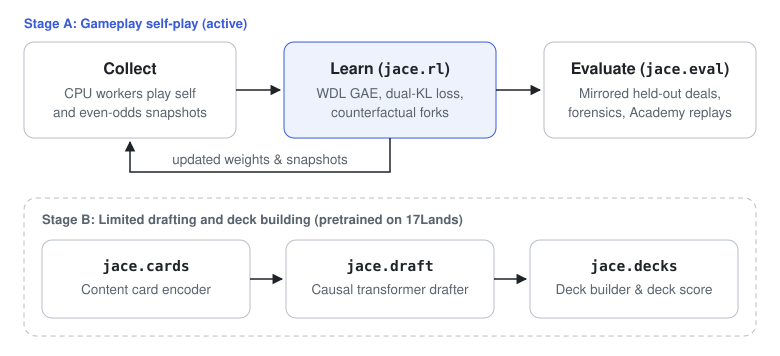

# jace

jace is a self-play reinforcement learning system for Magic: The Gathering on
the `managym` Rust rules engine. A shared program-reading card encoder
generalizes across unseen cards and formats, with Limited (draft, deck building,
and play) as the flagship end-to-end benchmark.

> [!NOTE]
> Work in progress. Development currently focuses on Phase A (format-agnostic
> gameplay self-play); Phase B connects drafting and deck building into the full
> Limited loop.

<picture>
  <source media="(prefers-color-scheme: dark)" srcset="assets/approach-dark.svg">
  
</picture>

## Approach

Magic couples hidden information, vast card pools, and multi-stage decisions. In
Limited, an agent drafts from unseen boosters, builds a 40-card deck, and plays
with hidden hands, libraries, and decklists.

- **Shared program card encoder.** Models read `managym` engine program tokens
  alone, with no per-card IDs, fixed card heads, or usage stats, so unseen cards
  generalize across sets and formats from their mechanics.
- **Format-agnostic gameplay and Limited stages.** A closed-decklist
  actor-critic with a 3-class Win/Draw/Loss (WDL) critic plays any legal deck.
  For Limited, a causal transformer drafts in 8-seat pods and a 3-stage masked
  set transformer builds and scores legal 40-card decks on top of the same card
  representation.
- **Stabilized self-play and evaluation.** Training pairs undiscounted WDL GAE,
  top-fraction advantage filtering, a damped dual-KL loss, even-odds snapshots,
  color-balanced curricula, and counterfactual forks. Evaluation uses mirrored
  paired deals, adaptive stopping, forensics, and probe diffs.

## Quick start

Requires Python 3.13, [uv](https://docs.astral.sh/uv/), and Rust (to compile
`managym`).

```sh
git clone https://github.com/RyanSaxe/jace.git
cd jace
uv sync
uv run pytest -q                              # unit tests
uv run python -m jace.train.ten_decks --help  # 10-deck lab (no external data)
uv run python -m jace.train.full_data --help  # full 17Lands self-play
uv run python -m jace.pretrain.draft --help   # drafter & card encoder pretraining
uv run python -m jace.pretrain.decks --help   # deck builder & score pretraining
uv run scripts/colab_run.py --help            # Google Colab GPU launcher
```

See [Install](docs/getting-started/install.md) for setup and 17Lands data.

## Documentation

| Page                                                      | Topic                                             |
| --------------------------------------------------------- | ------------------------------------------------- |
| [Install](docs/getting-started/install.md)                | Setup, tests, smoke run, 17Lands data             |
| [Architecture](docs/concepts/architecture.md)             | Solution architecture, data flow, and boundaries  |
| [Gameplay RL](docs/concepts/gameplay-rl.md)               | Policy backbone, self-play loop, curricula, forks |
| [Limited models](docs/concepts/limited-models.md)         | Card encoder, drafter, deck builder, deck score   |
| [Evaluation](docs/concepts/evaluation.md)                 | Mirrored deals, adaptive judge, forensics, diffs  |
| [Running experiments](docs/guides/running-experiments.md) | Training, Colab, screening, replays, custom loops |
| [Data](docs/reference/data.md)                            | 17Lands/MTGJSON loaders, caching, CRC-32 splits   |
| [Run records](docs/reference/run-records.md)              | Gameplay folders, resume, locked pretraining runs |
| [Sources](docs/reference/sources.md)                      | Papers, repos, and datasets behind the design     |
| [Contributing](docs/contributing/README.md)               | Setup, checks, package layout, CLIs, and testing  |

## Notice

jace is unofficial Fan Content permitted under the Fan Content Policy. Not
approved/endorsed by Wizards. Portions of the materials used are property of
Wizards of the Coast. ©Wizards of the Coast LLC.
