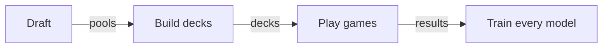

# jace

jace learns to draft, build decks and play Magic: The Gathering by self-play.
It plays its games on the engine from
[manabot](https://github.com/loopflowstudio/manabot).

> **Status: early.** Every module has a first version with tests. Nothing has
> been trained on Magic yet. [Status](docs/status.md) lists what works.

## Get started

You need Python 3.12, [uv](https://docs.astral.sh/uv/) and a Rust toolchain.
Installing builds manabot's engine from source.

```sh
git clone https://github.com/RyanSaxe/jace.git
cd jace
uv sync
uv run pytest -q
```

To see training work, run the smallest example. It needs no game engine:

```sh
uv run python -m jace.loops.toy
```

```text
iteration  1  best card 0.36  win rate 0.56
iteration 20  best card 0.59  win rate 0.60
iteration 40  best card 0.78  win rate 0.74
```

The player learns a toy game where the highest card wins. The output above
shows three of its nine lines.

## How it works



Training repeats these four steps. Five models take part, and all of them
read cards through one shared card embedding.

| Model        | Job                                      |
| ------------ | ---------------------------------------- |
| Drafter      | Picks a card from each pack              |
| Deck builder | Proposes decks from a pool of picks      |
| Deck score   | Predicts how often a deck wins           |
| Guess model  | Predicts the opponent's deck and hand    |
| Player       | Chooses each action in a game            |

jace has no trainer class. A training loop is a short function you write
from the package's pieces, and
[`jace.loops.limited`](src/jace/loops/limited.py) is the example to read
first. Constructed play is the same code without the draft step.

## Modules

| Module          | Holds                                        |
| --------------- | -------------------------------------------- |
| `jace.cards`    | Card records and the shared card embedding   |
| `jace.engine`   | `GameBatch`, the one way games are played    |
| `jace.draft`    | Boosters, the draft pod, the drafter         |
| `jace.decks`    | The deck score and the deck builder          |
| `jace.play`     | The guess model and the player               |
| `jace.train`    | Game collection, losses, the update step     |
| `jace.eval`     | Win rates and the guess model's check        |
| `jace.tracking` | Run records as plain files                   |
| `jace.loops`    | Example loops and schedules                  |

## Documentation

| Read                                              | To learn                                  |
| ------------------------------------------------- | ----------------------------------------- |
| [Install](docs/getting-started/install.md)        | Requirements, tests, the pre-commit hook  |
| [Architecture](docs/concepts/architecture.md)     | What each module owns and imports         |
| [Models](docs/concepts/models.md)                 | The card embedding and the five models    |
| [Training](docs/concepts/training.md)             | Game collection, losses and schedules     |
| [Write a loop](docs/guides/write-a-loop.md)       | How the limited loop works and changes    |
| [Run records](docs/reference/run-records.md)      | The files a run writes                    |
| [Status](docs/status.md)                          | What works today and what is not built    |
| [Contributing](docs/contributing/README.md)       | The checks and the design rules           |

## Licence

A licence has not been chosen yet.

## Notice

jace is unofficial Fan Content permitted under the Fan Content Policy. Not
approved/endorsed by Wizards. Portions of the materials used are property of
Wizards of the Coast. ©Wizards of the Coast LLC.
