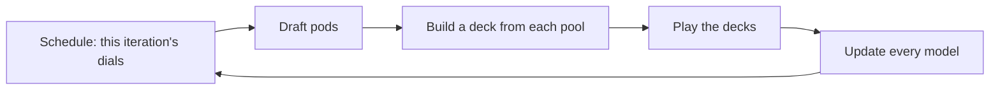

# jace

jace learns to draft, build decks and play Magic: The Gathering by self-play.
It is a Python 3.12 and PyTorch project that plays its games on the engine
from [manabot](https://github.com/loopflowstudio/manabot). A drafter picks
cards, a deck builder turns each pool of picked cards into a deck, and a
player plays the games. The results of those games train all three.

> **Status: early.** A first version of every module exists and is tested.
> Nothing has been trained beyond single update steps, and the whole limited
> loop has run only on a toy game. [Status](docs/status.md) lists what works
> and what is not built yet.

## Get started

jace needs Python 3.12, [uv](https://docs.astral.sh/uv/) and a Rust
toolchain, because installing it builds manabot's engine from source.

```sh
git clone https://github.com/RyanSaxe/jace.git
cd jace
uv sync
uv run pytest -q
uv run python -m jace.loops.toy
```

The last command runs the smallest example loop. It trains a player on High
Card, a toy game where each seat holds three cards, picks one, and the higher
pick wins. It prints how often the player picked its highest card, which is
the best play:

```text
iteration  1  best card 0.36  win rate 0.56
iteration  5  best card 0.41  win rate 0.53
iteration 10  best card 0.44  win rate 0.58
iteration 15  best card 0.51  win rate 0.59
iteration 20  best card 0.59  win rate 0.60
iteration 25  best card 0.65  win rate 0.69
iteration 30  best card 0.69  win rate 0.74
iteration 35  best card 0.69  win rate 0.72
iteration 40  best card 0.78  win rate 0.74
```

[Install](docs/getting-started/install.md) covers the requirements and the
pre-commit hook.

## How it works



One iteration of limited training runs those five steps. A schedule gives the
iteration its dials, such as learning rates and how much to explore. The
drafter drafts several pods, the deck builder builds a deck from each seat's
pool, and the player plays the decks against each other. The game results
then update the player, the model that guesses the opponent's hidden cards,
the deck score, the deck builder and the drafter.

jace has no trainer class and no framework. A training loop is a short
function you write from the modules below, and `jace.loops.limited` is one
example. Constructed play is the same code without `jace.draft`.

| Module          | Owns                                                                                                    |
| --------------- | ------------------------------------------------------------------------------------------------------- |
| `jace.cards`    | Card records, the pool that gives each card its id, and the one card embedding every model reads        |
| `jace.engine`   | `GameBatch`, the interface every caller plays games through, implemented on manabot and on a toy game   |
| `jace.draft`    | Boosters, the draft pod, whole drafts across pods, and the drafter model                                |
| `jace.decks`    | The deck score, and a deck builder that proposes whole decks and improves them by swaps                 |
| `jace.play`     | The guess model, which predicts the opponent's deck and hand, and the player model                      |
| `jace.train`    | The pieces a loop is written from: game collection, advantages, losses and the update step              |
| `jace.eval`     | A win rate with a range, and a check that the guess model's stated chances come true                    |
| `jace.tracking` | A run's record as plain files                                                                           |
| `jace.loops`    | The example loops, on the toy game and for limited, and the schedules that set a loop's dials           |
| `jace.modules`  | Two helpers every model shares                                                                          |

## Documentation

- [Install](docs/getting-started/install.md) lists the requirements and
  explains how to install jace, run the tests and run the example.
- [Architecture](docs/concepts/architecture.md) explains what each module
  owns, which module imports which, and the `GameBatch` interface.
- [Models](docs/concepts/models.md) explains the card embedding and the five
  models that read it.
- [Training](docs/concepts/training.md) explains game collection, the
  losses, the player's update rule and schedules.
- [Write a loop](docs/guides/write-a-loop.md) walks through the limited loop
  and explains how to change it.
- [Run records](docs/reference/run-records.md) describes the files a run
  writes to disk.
- [Status](docs/status.md) lists what works today, how it was checked, and
  what is not built yet.
- [Contributing](docs/contributing/README.md) explains the checks, the
  layout and the design rules.

## Licence

A licence has not been chosen yet.

## Notice

jace is unofficial Fan Content permitted under the Fan Content Policy. Not
approved/endorsed by Wizards. Portions of the materials used are property of
Wizards of the Coast. ©Wizards of the Coast LLC.
