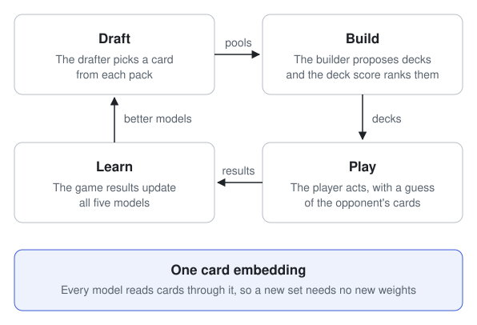

# jace

jace learns to draft, build decks and play Magic: The Gathering by playing
against itself. It plays its games on the engine from
[manabot](https://github.com/loopflowstudio/manabot).

> **Status: early.** Every part below has a first version with tests. Nothing
> has been trained on Magic yet. [Status](docs/status.md) says what works.

## The approach

<picture>
  <source media="(prefers-color-scheme: dark)" srcset="assets/approach-dark.svg">
  
</picture>

Limited Magic is three decisions that depend on each other: which card to
pick, which 40 cards to play, and what to do each turn. jace trains a model
for each, and lets the result of every game teach all of them.

| Model        | Decides                                 | Learns from                         |
| ------------ | --------------------------------------- | ----------------------------------- |
| Drafter      | Which card to take from a pack          | How often its decks win             |
| Deck builder | Which 40 cards to play from a pool      | The best deck a search found        |
| Deck score   | How good a deck is                      | Which decks won and lost            |
| Guess model  | What the opponent's deck and hand hold  | The opponent's true cards           |
| Player       | Each action in a game                   | Whether it won                      |

Three ideas hold the design together:

- **One card embedding.** Every model reads a card as the same vector, and
  scores cards by that vector. A card from a new set can be drafted and
  played without retraining an output layer.
- **A guess of hidden cards.** A separate model predicts the opponent's deck
  and hand from what has happened, and the player reads its guess. Self-play
  knows the true cards, so the guess is trained on real answers.
- **Exploring on a schedule.** How much each model explores, and how fast it
  learns, are values a schedule sets for every round of training.

[The approach](docs/concepts/approach.md) explains each idea.

## Try it

You need Python 3.12, [uv](https://docs.astral.sh/uv/) and a Rust toolchain,
because installing builds manabot's engine.

```sh
git clone https://github.com/RyanSaxe/jace.git
cd jace
uv sync
uv run pytest -q                   # 45 tests, about 3 seconds
uv run python -m jace.loops.toy    # train a player on a toy game
```

The last command needs no game engine. The player learns a game where the
highest card wins, and prints how often it picks its best card:

```text
iteration  1  best card 0.36  win rate 0.56
iteration 20  best card 0.59  win rate 0.60
iteration 40  best card 0.78  win rate 0.74
```

## Documentation

| Page                                           | What it explains                               |
| ---------------------------------------------- | ---------------------------------------------- |
| [The approach](docs/concepts/approach.md)      | The training loop and the ideas behind it      |
| [Architecture](docs/concepts/architecture.md)  | The modules and how games reach them           |
| [Models](docs/concepts/models.md)              | What each model reads and returns              |
| [Training](docs/concepts/training.md)          | From played games to a gradient step           |
| [Write a loop](docs/guides/write-a-loop.md)    | How to assemble and change a training loop     |
| [Run records](docs/reference/run-records.md)   | The files a training run writes                |
| [Status](docs/status.md)                       | What works today and what is not built         |
| [Contributing](docs/contributing/README.md)    | Set-up, checks and the design rules            |

## Licence

A licence has not been chosen yet.

## Notice

jace is unofficial Fan Content permitted under the Fan Content Policy. Not
approved/endorsed by Wizards. Portions of the materials used are property of
Wizards of the Coast. ©Wizards of the Coast LLC.
