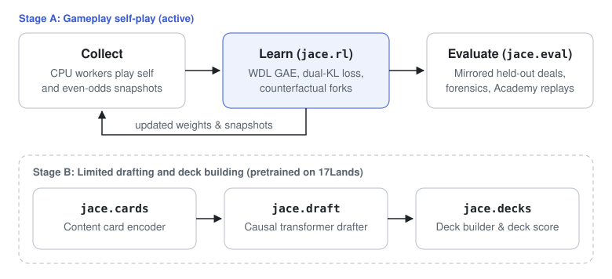

# The approach

jace learns limited Magic by self-play: it drafts, builds decks and plays
games against itself, and the results of those games are the only reward.

<picture>
  <source media="(prefers-color-scheme: dark)" srcset="../../assets/approach-dark.svg">
  
</picture>

## Why one loop

A pick is good only if it leads to a deck that wins, and a deck wins only in
the hands of a player who can pilot it. So the three skills cannot be judged
apart.

jace plays whole rounds of draft, build and play, and uses the game
results to improve every model at once.

## What each model learns from

| Model        | Signal                                                        | Kind of learning |
| ------------ | ------------------------------------------------------------- | ---------------- |
| Player       | Whether it won the game                                       | Reinforcement    |
| Drafter      | The win rate of the deck built from its picks                 | Reinforcement    |
| Deck score   | Which decks won and lost                                      | Supervised       |
| Deck builder | How each of its builds won against its pool's other builds    | Reinforcement    |
| Guess model  | The opponent's true deck and hand, which self-play knows      | Supervised       |

The player, the drafter and the builder learn from reward. The deck score
and the guess model have exact answers to learn from, which makes them
cheaper to train. The builder learns only once the deck score that learns
from self-play predicts the games better than the one trained on human
decks, because until then the search ranks decks by human results.

## One card embedding

A card encoder makes one vector for each card, and every model reads it. The
encoder reads three things a card has before anyone plays it: its printed
text, as a frozen language model embeds it, its engine program and a few
printed facts such as mana value, colours and rarity. A card's vector
depends on that card alone. No vector holds 17Lands statistics.

Models never have an output with one slot per card. To choose a card, a
model produces a query vector and scores each candidate by its embedding.

A card the model has never seen still has an embedding, so it can be
scored. This is how jace is meant to reach a new set without retraining.

The drafter's pretraining on human picks trains the encoder. Every later
stage reads its vectors as a fixed table. [Models](models.md) describes the
encoder and [Data](../reference/data.md) its inputs.

## A guess of the opponent's cards

Magic hides the opponent's hand and deck. A separate guess model predicts
both at every decision, and the player reads the guess as part of its
input.

The guess model also reads its own earlier guesses from the same
game, so what it worked out on turn 2 is still there on turn 8.

During self-play the true cards are known, so every decision is a labelled
example. A confident wrong guess costs more than an unsure one, which
teaches the model to say how sure it is.

## Exploring on a schedule

The drafter and the deck builder start from human data, which puts them
near how people already play. Without exploring, they stay there.
So the amount of exploring is explicit:

- The player, the drafter and the builder sample their choices.
- A term in each loss keeps their odds from collapsing early.
- The loop plays several of each pool's top-scored decks, one in each block
  of games.

A schedule sets these values, and the learning rates, for every iteration.
[Training](training.md#dials-on-a-schedule) shows one.

[Status](../status.md) has the results of pretraining on human data and of
the first run of the whole loop.
