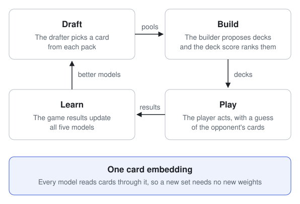

# The approach

jace learns limited Magic by self-play: it drafts, builds decks and plays
games against itself, and the results of those games are the only reward.

<picture>
  <source media="(prefers-color-scheme: dark)" srcset="../../assets/approach-dark.svg">
  
</picture>

## Why one loop

A pick is good only if it leads to a deck that wins, and a deck wins only in
the hands of a player who can pilot it. So the three skills cannot be judged
apart. jace plays whole rounds of draft, build and play, and uses the game
results to improve every model at once.

## What each model learns from

| Model        | Signal                                                        | Kind of learning |
| ------------ | ------------------------------------------------------------- | ---------------- |
| Player       | Whether it won the game                                       | Reinforcement    |
| Drafter      | The win rate of the deck built from its picks                 | Reinforcement    |
| Deck score   | Which decks won and lost                                      | Supervised       |
| Deck builder | The best deck a search found for the pool                     | Supervised       |
| Guess model  | The opponent's true deck and hand, which self-play knows      | Supervised       |

Only the player and the drafter learn from reward. The other three have
exact answers to learn from, which makes them cheaper to train.

## One card embedding

Each card has a fixed starting vector. A small head, shared by all cards,
adjusts it, and every model reads the result.

Models never have an output with one slot per card. To choose a card, a
model produces a query vector and scores each candidate by its embedding.
A card the model has never seen still has an embedding, so it can be
scored. This is how jace is meant to reach a new set without retraining.

The starting vectors are meant to come from a card's rules text and its
engine program. That step is not built: the tests use random vectors.

## A guess of the opponent's cards

Magic hides the opponent's hand and deck. A separate guess model predicts
both at every decision, and the player reads the guess as part of its
input. The guess model also reads its own earlier guesses from the same
game, so what it worked out on turn 2 is still there on turn 8.

During self-play the true cards are known, so every decision is a labelled
example. A confident wrong guess costs more than an unsure one, which
teaches the model to say how sure it is.

## Exploring on a schedule

The drafter and the deck builder are meant to start from human data, which
puts them near how people already play. Without exploring, they stay there.
So the amount of exploring is explicit:

- The player and the drafter sample their choices.
- A term in each loss keeps their odds from collapsing early.
- For a share of pools, the loop plays a deck other than the top-scored one.

A schedule sets these values, and the learning rates, for every iteration.
[Training](training.md#dials-on-a-schedule) shows one.

Loading human data and pretraining on it are not built yet.
[Status](../status.md) lists what is.
