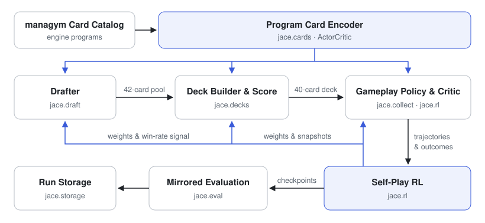

# Architecture

Magic: The Gathering poses three coupled difficulties for reinforcement
learning. The card pool spans thousands of distinct cards and grows with every
new set. Games have hidden information in hands, libraries, and closed opponent
decklists. In Limited formats, decisions also span three distinct stages:
drafting from unseen boosters, building a legal 40-card deck, and playing out
the games.

jace addresses all three with one architectural thesis: **every model reads
cards through a shared program-reading card encoder, feeding a format-agnostic
gameplay self-play core, with Limited plugging in as the flagship end-to-end
benchmark.** No model uses per-card IDs, fixed card output heads, or human usage
statistics. Because cards are represented strictly by their executable `managym`
rules programs, policies and value estimators transfer across unseen cards,
sets, and formats from mechanics alone.

## How the system works end to end

<picture>
  <source media="(prefers-color-scheme: dark)" srcset="../assets/architecture-flow-dark.svg">
  
</picture>

Data, card vectors, trajectories, weights, and checkpoints move through four
connected layers.

### 1. Representation layer

`managym` compiles every deck-eligible card into a token sequence describing its
rules program (`jace.data.catalog`, `program_tokens`). In `jace.cards`,
`CardEncoder` maps those token sequences to dense card vectors and can freeze
them into a parameter-free `CardTable`. Downstream models depend only on the
`CardVectors` protocol, so the encoder can be trained during draft pretraining
and then shared as a frozen lookup table without leaking gradients or adding
card-ID lookup tables.

During gameplay training, `ActorCritic` runs its semantic card program encoder
once per epoch over the active catalog instead of re-encoding cards at every
decision step. That keeps observation cost bounded even as curricula expand
across hundreds of cards.

### 2. Format-agnostic gameplay self-play core

Gameplay self-play makes no assumptions about how a deck was produced. Any legal
deck source works, from the 10-deck lab to cached 17Lands decks or constructed
decks.

- **Policy and critic (`jace.collect.agent`).** A closed-decklist `ActorCritic`
  reads v11 observations (cards, permanents, stack, and optional decision
  memory), scores legal moves through a FiLM-conditioned action head, and
  estimates outcomes with a 3-class Win/Draw/Loss (WDL) critic.
- **Parallel collection (`jace.collect`).** Persistent CPU worker processes
  (`MultiProcessCollector`) or local collectors (`LocalShardedCollector`) play
  complete games under a frozen behavior snapshot, isolate per-game engine
  errors, and pack trajectories (including compact decision-memory archives)
  back to the learner.
- **Pure-tensor learner (`jace.rl`).** `jace.rl.loop` feeds collected
  trajectories into pure PyTorch/NumPy RL routines: undiscounted WDL GAE
  (`gae_wdl`), top-fraction advantage filtering (`top_fraction`), and the
  Ataraxos dual-KL damped objective (`damped_policy_loss`) over length-bucketed
  minibatches.
- **Opponent diversity and intervention (`jace.rl.pool`, `jace.forks`).**
  `SnapshotPool` keeps a bounded FIFO ring of CPU checkpoints and pairs seats by
  even-odds EMA win rate so self-play avoids cyclic forgetting. When a policy
  collapses onto a low-entropy habit (such as attacking blindly every turn),
  `jace.forks` clones exact `managym` states (`env.clone_env()`), runs batched
  counterfactual playouts over alternative actions, and adds pairwise
  cross-entropy supervision.

See [Gameplay RL](gameplay-rl.md) for the loss equations, schedules, and
curriculum details.

### 3. Scientific evaluation and provenance

Opening hands, mana screw, and play/draw order introduce large single-game
variance. `jace.eval` separates real policy gains from deal noise:

- **Mirrored paired deals (`jace.eval.deals`, `jace.eval.parallel`).** Every
  evaluation deal plays two legs with identical decklists and library shuffles
  but swapped seats, on decks drawn strictly from the held-out CRC-32 split.
- **Adaptive judging and diagnostics (`jace.train.harness`,
  `jace.eval.forensics`, `jace.eval.diffs`).** Sequential stages
  (`100 -> 200 -> 500` deals) stop early when confidence intervals separate
  clearly, while behavioral forensics against `managym.Heuristic` and
  deterministic probe-state diffs catch tactical regressions that raw win rate
  can hide.
- **Plain-file run storage (`jace.storage`).** Gameplay runs write
  Academy-compatible `.safetensors` checkpoints, `.policy.json` specs, replays,
  and atomically renamed `resume-state.pt` bundles so preempted local or Colab
  runs resume cleanly at `iteration + 1`. Pretraining runs acquire an OS
  `flock`, track explicit lifecycle transitions, and verify SHA-256 digests on
  every checkpoint before loading.

See [Evaluation](evaluation.md) and [Run records](../reference/run-records.md)
for the exact protocols and file layouts.

### 4. Limited extension (Phase B)

Limited extends the system into an end-to-end draft, build, and play loop using
the same card representation and gameplay engine:

- **Drafter (`jace.draft`).** `DrafterModel` runs a causal transformer over a
  seat's pick sequence across batched 8-seat booster pods, turning packs into a
  42-card pool.
- **Deck builder and scorer (`jace.decks`).** `DeckBuilder` samples legal
  40-card decks through a 3-stage masked set transformer that enforces
  `BuildRules` at every step, and `DeckScore` ranks candidate builds by
  predicted win probability before handing decks to the gameplay policy.

In Phase B, self-play win rates and updated weights flow back from gameplay into
the drafter and deck models so all three stages improve together. See
[Limited models](limited-models.md) for model internals.

## Architectural boundaries and why they exist

<picture>
  <source media="(prefers-color-scheme: dark)" srcset="../assets/modules-dark.svg">
  
</picture>

jace organizes its packages into a strict downward DAG (and right-to-left within
a row). Four seams do most of the structural work:

- **Pure-tensor RL math stays engine-free (`jace.rl`).** Every module in
  `jace.rl` except `loop.py` uses only PyTorch and NumPy and cannot import
  `managym`, `manabot`, `jace.collect`, or Limited packages. Separating the math
  from the simulator lets credit assignment, advantage filtering, KL losses,
  schedules, and snapshot pools run in fast, deterministic unit tests on
  synthetic tensors, and keeps the RL algorithms reusable across formats.
- **The `managym` and `manabot` boundary is explicit.** Only designated seam
  modules (`data.catalog`, `rl.loop`, `collect`, `eval`, `forks`,
  `storage.gameplay`, `train`) may import the Rust engine or upstream runtime,
  and no module may import upstream training loops or learner recipes. Upstream
  API churn stays contained to thin adapters while jace retains full ownership
  of its training algorithms.
- **Format-agnostic layers never depend on Limited or higher orchestration.**
  Leaf packages (`modules`, `cards`, `data`, `storage.pretrain`) cannot import
  higher layers; `jace.collect` cannot import `eval`, `forks`, `pretrain`, or
  `train`; and only top-level entry points (`jace.pretrain`, `jace.train`) may
  import `jace.draft`. Constructed or deck-only gameplay therefore carries zero
  dependency on drafting code, and CLI entry points cannot turn into hidden
  library dependencies.
- **State machines and storage have single owners.** Each stateful component
  (draft pod progression, pretraining run locking, historical snapshot ring, and
  spawned worker pool) is owned by one module, and disk artifacts are written
  atomically with hash verification so evaluation and resume never read
  half-written state.

For the package directory table, CLI entry points, and state-machine ownership
map, see [Contributing](../contributing/README.md).
