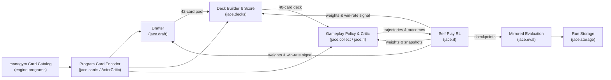

# Architecture

jace organizes Limited Magic learning into small, focused packages plus
standalone operational scripts in `scripts/`, governed by an acyclic dependency
graph.

## End-to-end data and model flow

## Package layers

<picture>
  <source media="(prefers-color-scheme: dark)" srcset="../assets/modules-dark.svg">
  
</picture>

| Package / path | Responsibility |
| --- | --- |
| `jace.train` | Top-level gameplay self-play CLIs (`full_data`, `ten_decks`, `harness`) |
| `jace.pretrain` | Supervised pretraining CLIs and helpers (`draft`, `decks`, `common`, `formats`, `schedules`, `supervised`, `deck_measures`) |
| `jace.forks` | Counterfactual fork collection, batched playouts, and horizon audits (`collect`, `batch`, `audit`) |
| `jace.eval` | Mirrored paired deals, parallel adaptive judging, forensics, and probe diffs (`deals`, `parallel`, `forensics`, `diffs`) |
| `jace.collect` | v11 `ActorCritic` factory, deck/curriculum loading, and in-process / multi-process collectors (`agent`, `decks`, `local`, `pool`) |
| `jace.rl` | Pure-tensor RL math (`credit`, `losses`, `select`, `schedules`, `ema`, `pool`, `prefetch`, `diagnostics`) and training `loop` |
| `jace.draft` | Booster specs, multi-pod draft state machine, and causal transformer `DrafterModel` |
| `jace.decks` | `DeckBuilder`, `DeckScore`, `BuildRules`, and batch-sampled deck search |
| `jace.storage` | Gameplay run folders (`gameplay.py`) and file-locked, SHA-256 verified pretraining run records (`pretrain.py`) |
| `jace.cards` | `CardPool`, program-based `CardEncoder`, and frozen `CardTable` |
| `jace.data` | 17Lands and MTGJSON loaders, deterministic CRC-32 splits, program tokens, and `catalog` seam |
| `jace.modules` | Shared transformer builder, packed unpadded `encode_real`, and accelerator selection |
| `scripts/` | Standalone operational scripts with PEP 723 metadata (such as `colab_run.py`) |

## Enforced import boundaries

`ast-grep` rules in `.byor/rules/project/` enforce the module graph on every
commit and CI run:

| Rule | Contract |
| --- | --- |
| `jace.no-manabot-learner-recipes` | All RL updates, schedules, and loops live in `jace.rl` |
| `jace.manabot-import-boundaries` | Only `jace.data.catalog`, `jace.rl.loop`, `jace.collect`, `jace.eval`, `jace.forks`, `jace.storage.gameplay`, and `jace.train` touch the engine |
| `jace.pure-rl-math-boundaries` | Every `jace.rl` module except `__init__.py` and `loop.py` stays pure PyTorch/NumPy math and never imports `jace.rl.loop` |
| `jace.collect-stays-below-eval` | `jace.collect` never imports `jace.eval`, `jace.forks`, `jace.pretrain`, or `jace.train` |
| `jace.leaf-packages-stay-leaf` | `jace.cards`, `jace.data`, `jace.modules`, `jace.storage.__init__`, and `jace.storage.pretrain` never import higher layers |
| `jace.only-entry-points-import-draft` | Outside `jace.draft`, only `jace.pretrain` and `jace.train` import `jace.draft` |
| `jace.nothing-imports-pretrain` | Nothing outside `jace.pretrain` imports `jace.pretrain` |
| `jace.nothing-imports-train` | Nothing outside `jace.train` imports `jace.train` |

## Entry points

| Command | Purpose |
| --- | --- |
| `uv run python -m jace.train.ten_decks` | Self-play lab on 10 built-in elemental decks with optional forks |
| `uv run python -m jace.train.full_data` | Full 17Lands self-play with nested curricula, snapshots, and resume |
| `uv run python -m jace.train.harness` | Fast screening and standalone `--eval-only` adaptive head-to-head |
| `uv run python -m jace.pretrain.draft` | Supervised pretraining of `DrafterModel` and `CardEncoder` |
| `uv run python -m jace.pretrain.decks` | Supervised pretraining of `DeckScore` and `DeckBuilder` |
| `uv run scripts/colab_run.py` | Provision, sync, and tear down Google Colab GPU training sessions |

## Explicit state machines

| Component | States | Owner |
| --- | --- | --- |
| Draft pod | `Picking` -> `Complete` | `jace.draft.pod.advance` |
| Pretraining run | `created` -> `running` -> `completed` / `failed` / `interrupted` | `jace.storage.pretrain.writing` |
| Historical pool | Bounded FIFO ring of CPU weight snapshots + EMA win rates | `jace.rl.pool.SnapshotPool` |
| Worker pool | Persistent spawned CPU workers (`req_queues` / `res_queue`) | `jace.collect.pool.MultiProcessCollector` |
