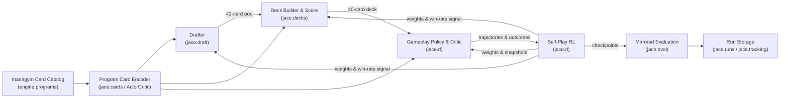

# Architecture

jace organizes Limited Magic learning into ten small packages with a strict acyclic dependency graph.

## End-to-end data and model flow

## Package layers

<picture>
  <source media="(prefers-color-scheme: dark)" srcset="../assets/modules-dark.svg">
  
</picture>

| Package         | Responsibility                                                                                |
| --------------- | --------------------------------------------------------------------------------------------- |
| `jace.loops`    | CLI entry points, multi-process collector, batched forks, fast screening harness, format specs |
| `jace.rl`       | Pure-tensor RL math (`credit`, `losses`, `select`, `pool`, `diagnostics`) and training `loop` |
| `jace.eval`     | Mirrored paired deals, parallel CPU eval, adaptive judge, forensics, probe diffs, deck splits |
| `jace.draft`    | Booster specs, multi-pod draft state machine, and causal transformer `DrafterModel`           |
| `jace.decks`    | `DeckBuilder`, `DeckScore`, `BuildRules`, and batch-sampled deck search                       |
| `jace.runs`     | Gameplay run folders (`.safetensors`, `.policy.json`, JSONL metrics, atomic resume)           |
| `jace.tracking` | File-locked, SHA-256 verified pretraining run records                                         |
| `jace.cards`    | `CardPool`, program-based `CardEncoder`, and frozen `CardTable`                               |
| `jace.data`     | 17Lands and MTGJSON loaders, deterministic CRC-32 splits, program tokens, `catalog` seam      |
| `jace.modules`  | Shared transformer builder and packed unpadded `encode_real`                                  |

## Enforced import boundaries

Six `ast-grep` rules in `.byor/rules/project/` enforce the module graph on every commit and CI run:

| Rule                              | Contract                                                                                   |
| --------------------------------- | ------------------------------------------------------------------------------------------ |
| `jace.no-manabot-learner-recipes` | All RL updates, schedules, and loops live in `jace.rl`                                     |
| `jace.manabot-import-boundaries`  | Only `jace.data.catalog`, `jace.rl.loop`, `jace.eval`, `jace.runs`, and `jace.loops` touch the engine |
| `jace.pure-rl-math-boundaries`    | `jace.rl.credit`, `jace.rl.losses`, and `jace.rl.select` stay pure PyTorch/NumPy math      |
| `jace.leaf-packages-stay-leaf`    | `jace.cards`, `jace.data`, `jace.modules`, and `jace.tracking` never import higher layers  |
| `jace.only-loops-import-draft`    | Outside `jace.draft`, only `jace.loops` imports `jace.draft`                               |
| `jace.nothing-imports-loops`      | Loops are top-level wiring only                                                            |

## CLI entry points

| Module                       | Purpose                                                               |
| ---------------------------- | --------------------------------------------------------------------- |
| `jace.loops.train_ten_decks` | Self-play lab on 10 built-in elemental decks with optional forks      |
| `jace.loops.train_full_data` | Full 17Lands self-play with nested curricula, snapshots, and resume   |
| `jace.loops.harness`         | Fast screening and standalone `--eval-only` adaptive head-to-head     |
| `jace.loops.pretrain`        | Supervised pretraining of `DrafterModel` and `CardEncoder`            |
| `jace.loops.pretrain_decks`  | Supervised pretraining of `DeckScore` and `DeckBuilder`               |

## Explicit state machines

| Component       | States                                                          | Owner                                           |
| --------------- | --------------------------------------------------------------- | ----------------------------------------------- |
| Draft pod       | `Picking` → `Complete`                                          | `jace.draft.pod.advance`                        |
| Pretraining run | `created` → `running` → `completed` / `failed` / `interrupted` | `jace.tracking.writing`                         |
| Historical pool | Bounded FIFO ring of CPU weight snapshots + EMA win rates       | `jace.rl.pool.SnapshotPool`                     |
| Worker pool     | Persistent spawned CPU workers (`req_queues` / `res_queue`)     | `jace.loops.collect_pool.MultiProcessCollector` |
