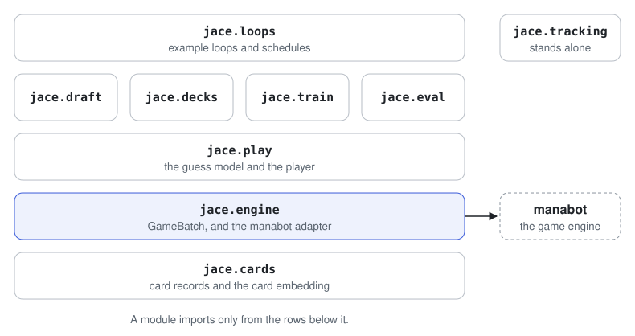

# Architecture

jace is a set of modules that a training loop calls. This page shows what
each module owns and how games reach the code that learns from them.

<picture>
  <source media="(prefers-color-scheme: dark)" srcset="../assets/modules-dark.svg">
  
</picture>

| Module          | Owns                                                      |
| --------------- | --------------------------------------------------------- |
| `jace.cards`    | Card records, card ids and the shared card embedding      |
| `jace.engine`   | `GameBatch`, the interface games are played through       |
| `jace.play`     | The guess model and the player                            |
| `jace.draft`    | Boosters, the draft pod and the drafter                   |
| `jace.decks`    | The deck score and the deck builder                       |
| `jace.train`    | Game collection, the losses and the update step           |
| `jace.eval`     | Win rates and the check on the guess model                |
| `jace.loops`    | Example training loops and schedules                      |
| `jace.tracking` | A training run's record on disk                           |

## Games go through one interface

Everything that plays a game uses `GameBatch`. It steps many games at once,
and a single game is a batch of one.

```python
class GameBatch(Protocol):
    def decisions(self) -> Decisions: ...
    def act(self, actions: npt.NDArray[np.int64]) -> tuple[Finished, ...]: ...
    def hidden_cards(self) -> HiddenCards: ...
```

| Method         | Returns                                                             |
| -------------- | ------------------------------------------------------------------- |
| `decisions`    | The pending decision in every game: who acts, the board they see    |
| `act`          | The games that ended on this step, with their decks and outcome     |
| `hidden_cards` | Both seats' true hands and libraries, for training the guess model  |

A slot always holds a game waiting on a decision. When a game ends, the slot
starts the next matchup before `act` returns.

Two things implement the interface:

- `jace.engine.manabot` plays real Magic. It is the only file that imports
  manabot, so a change in the engine reaches one file.
- `jace.engine.toy` plays High Card, a three-card game. Tests and the
  smallest example use it, so they need no engine.

## Pieces, not a framework

jace has no trainer class. `jace.train` holds functions: play these games,
compute this loss, take this step. A training loop is a function you write
by calling them, and `jace.loops` holds two examples.

Because only `jace.loops` imports `jace.draft`, constructed play is the same
code with the draft step left out.

## Where state lives

Most of jace is functions over values. Three things have real states, and
each is written as one type per state:

| Thing           | States                                           | Moved by               |
| --------------- | ------------------------------------------------ | ---------------------- |
| A draft pod     | `Picking`, `Complete`                            | `advance`              |
| A training run  | created, running, completed, failed, interrupted | `writing`              |
| A game          | A pending decision, or finished                  | `GameBatch.act`        |
