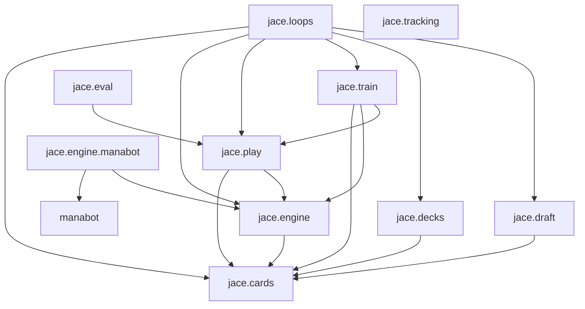

# Architecture

This page explains what each module owns, which module imports which, the two
import rules the linter enforces, the three state machines, and the
`GameBatch` interface that hides the game engine.

## Modules

Each module owns one part of the work. Nothing is exported from the package
root, so you import the module you need by name, such as `jace.train`.

| Module          | Owns                                                                                                                                 |
| --------------- | ------------------------------------------------------------------------------------------------------------------------------------ |
| `jace.cards`    | `CardRecord`, `CardPool` and the `CardId` it defines, and `CardEmbedding`, the one embedding every model reads.                      |
| `jace.engine`   | `GameBatch` and the values that cross it. `jace.engine.manabot` implements it on manabot, and `jace.engine.toy` on a toy game.       |
| `jace.draft`    | Booster generation, the draft pod, `run_drafts`, which drafts many pods at once, and `DrafterModel`.                                 |
| `jace.decks`    | `DeckScore`, `DeckBuilderModel`, the proposers, the swap search `improve`, and `build_decks`, which runs them for one pool.          |
| `jace.play`     | `GuessModel`, `PlayerModel`, and the `Policy` and `Guesser` function types that the rest of the package calls them through.          |
| `jace.train`    | `collect`, which plays games, the advantage calculation, the loss functions, and `apply`, which takes the gradient step.             |
| `jace.eval`     | `win_rate`, which gives a rate with a range, and `check_guess`, which compares the guess model's stated chances with what happened.  |
| `jace.tracking` | A run's record on disk: its identity, state, metrics, evaluations and checkpoints.                                                   |
| `jace.loops`    | The example loops `jace.loops.toy` and `jace.loops.limited`, and the schedules in `jace.loops.schedules`.                            |
| `jace.modules`  | `run`, a module call that checks the result is a tensor, and `transformer`, which builds the one encoder shape the models use.       |

## Imports

An arrow points from a module to a module it imports.



The diagram leaves out `jace.modules`, which `jace.cards`, `jace.draft`,
`jace.decks`, `jace.play` and `jace.loops` import. `jace.tracking` imports no
other jace module.

`jace.engine` does not import its manabot adapter. Importing `jace.engine`,
or any module above it in the diagram, therefore never loads manabot. The
code that starts real games imports `jace.engine.manabot` itself and passes
the batch in.

## Two import rules

Two lint rules keep the diagram true. Each is a file under
`.byor/rules/project/`, and a commit that breaks one fails the pre-commit
hook and CI.

| Rule                                                  | Why                                                                                                                                                         |
| ----------------------------------------------------- | ----------------------------------------------------------------------------------------------------------------------------------------------------------- |
| Only `src/jace/engine/manabot.py` imports manabot.    | Training, evaluation and tests depend on `GameBatch` and never on the engine. A change in manabot's API is a change to one file.                            |
| Only `jace.loops` imports `jace.draft`.               | Constructed play is the same code with the drafter left out. That holds only while decks, play, training, evaluation and tracking do not depend on drafts.  |

The types a draft shares with the other modules, `CardId`, `Pool` and `Deck`,
live in `jace.cards`. A module that needs the result of a draft takes it as a
plain argument, such as a pool, and the loop passes it in.

## State machines

Three parts of jace have real states, where what you may do next depends on
what happened before. Each one is explicit: the states are immutable values,
and one function moves between them. Everything else is a plain sequence of
calls.

### A draft pod

A pod is one draft table. It is in exactly one of two states, defined in
`jace.draft.pod`.

| State      | Meaning                                                    |
| ---------- | ---------------------------------------------------------- |
| `Picking`  | Every seat holds a pack and owes one pick.                 |
| `Complete` | The draft is over, and only each seat's pool remains.      |

```python
def open_pod(draft_format: DraftFormat, boosters: Sequence[Sequence[Pack]]) -> Picking
def advance(state: Picking, picks: Sequence[CardId]) -> PodState
```

`open_pod` seats the pod and opens the first round. `advance` is the only
transition. It takes every seat's pick at once, because seats pick at the
same time at a real table, and it returns `Picking` again or `Complete` after
the last pick of the last round. Packs pass to the next seat in even rounds
and to the previous seat in odd rounds, counting rounds from zero.

The pod owns the rules of the table and nothing else. It does not open
boosters and does not choose cards. A state is a frozen value, so you can
keep, compare or replay any point of a draft. An illegal pick raises before a
new state is built, so the state you hold stays valid.

### A batch of games

A `GameBatch` holds a fixed number of slots, and each slot always holds a
game that is waiting on a decision. `act` is the only transition: it applies
one action per slot. When an action ends a game, `act` reports the game as a
`Finished` value, and the slot starts the next matchup before `act` returns.

The engine's games live inside the batch. A caller sees two immutable values:
`Decisions`, the pending decision in every slot, and `Finished`, one ended
game.

`collect` in `jace.train` adds one more state. Games still running when it
stops are returned as a `Pending` value, and the next call on the same batch
takes that value and continues them. [Training](training.md#collect) explains
why.

### A run on disk

A run is one training run's record in a folder. `jace.tracking` defines its
states in `RunState`: created, running, completed, failed and interrupted.
The `writing` context manager is the only way into running, and it records
how the run ended when its block exits.

Every function that writes to a run takes a `Running` value, which only
`writing` makes. A write outside a `writing` block therefore fails the type
check. [Run records](../reference/run-records.md#states) lists each
transition.

## The GameBatch interface

`GameBatch` is a protocol in `jace.engine.batch`. Training and evaluation
step many games at once through it and never see the engine behind it. A
single game is a batch of one.

```python
class GameBatch(Protocol):
    def decisions(self) -> Decisions: ...
    def act(self, actions: npt.NDArray[np.int64]) -> tuple[Finished, ...]: ...
    def hidden_cards(self) -> HiddenCards: ...
```

| Method         | Returns                                                                                                                                                  |
| -------------- | -------------------------------------------------------------------------------------------------------------------------------------------------------- |
| `decisions`    | `Decisions`: the seat that must act in each slot, the boards that seat may see, and each slot's number of legal actions. Actions are numbered from 0.     |
| `act`          | The games that ended on this step, in slot order. Each `Finished` has the slot, the `Outcome` and the two decks the game was played with.                 |
| `hidden_cards` | `HiddenCards`: both seats' true hands and libraries in every slot, as a count per card.                                                                   |

`hidden_cards` exists to label training data for the guess model. It must
never reach a player.

A board is a mapping from a name to a NumPy array with a leading batch axis.
The names and shapes belong to the engine. In `jace.play`, only
`board_tokens` reads them, so a change of engine or of board layout is a
change to that one function.

### Two implementations

| Implementation                    | Game                                    | Used by                                    |
| --------------------------------- | --------------------------------------- | ------------------------------------------ |
| `jace.engine.manabot.start_batch` | Magic, on manabot's engine              | Tests of the adapter and of the real models |
| `jace.engine.toy.ToyBatch`        | High Card, with no engine               | Tests of training, and the example loops    |

```python
def start_batch(matchups: Callable[[], tuple[Deck, Deck]], *, pool: CardPool, games: int, seed: int) -> GameBatch
ToyBatch(matchups: Callable[[], tuple[Deck, Deck]], *, games: int, seed: int)
```

Both take `matchups`, a function that returns the two decks of the next game.
The batch calls it once per slot at the start, and again each time a game
ends.

The manabot adapter plays with closed decklists: a seat's board never shows
the opponent's deck, so the guess model has to infer it. Each game's seed
depends only on the batch seed, the slot and how many games the slot has
started, so two batches with one seed and the same actions play identically.
A deck the engine refuses raises `DeckRejectedError`.

The adapter also exposes the engine's card catalog. `engine_cards` lists
every card the engine accepts in a deck, with its name, set, Scryfall id,
rules text and learning tokens. The engine has no card rarity, so you must
add rarity from another source before you build a `CardPool` from it.

The adapter steps one scalar game per slot in a Python loop, because
manabot's batched mode does not expose hidden hands yet.
[Status](../status.md#known-limits) lists this with the adapter's other
limits.

In High Card, each seat holds three cards with distinct values and picks one.
Seat 0 picks first, seat 1 sees that pick, and the higher pick wins. Equal
picks deal both seats again, so games differ in length and the slots of a
batch drift out of step, as real games do. The best play is always the
highest card, which makes it easy to see whether training works.
