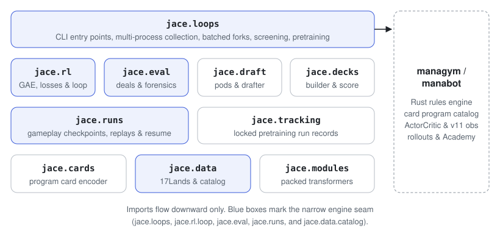

# Architecture

jace is organized into two stages and ten small packages with AST-enforced import boundaries:

- **Stage A (active gameplay self-play):** Trains a Magic player over `managym` using `manabot`'s `ActorCritic` backbone, jace's pure-tensor RL core (`jace.rl`), parallel mirrored evaluation (`jace.eval`), Academy-native run storage (`jace.runs`), and multi-process training loops (`jace.loops`).
- **Stage B (pretrained Limited pipeline):** Builds content-based card embeddings (`jace.cards`), downloads and caches 17Lands tables (`jace.data`), simulates booster pods and trains a drafter (`jace.draft`), and trains an autoregressive deck builder and deck score (`jace.decks`). These models are pretrained on human data and ready to reconnect into end-to-end Limited self-play.

<picture>
  <source media="(prefers-color-scheme: dark)" srcset="../assets/modules-dark.svg">
  
</picture>

## Package map

| Package         | Role                                                                                          |
| --------------- | --------------------------------------------------------------------------------------------- |
| `jace.rl`       | Pure-tensor RL math (`credit`, `losses`, `select`, `pool`, `diagnostics`) plus `loop` bridge  |
| `jace.eval`     | Mirrored deals, parallel CPU eval, adaptive judge, forensics, probe diffs, 17Lands deck splits |
| `jace.runs`     | Academy-native gameplay runs (`.safetensors`, `.policy.json`, JSONL metrics, atomic resume)   |
| `jace.loops`    | CLI entry points, multi-process collector, batched counterfactual forks, fast harness, formats |
| `jace.cards`    | Card records, `CardPool`, content-based `CardEncoder`, and frozen `CardTable`                 |
| `jace.data`     | 17Lands and MTGJSON loaders, deterministic CRC-32 splits, text/program caching, `catalog` seam |
| `jace.draft`    | Booster specs, multi-pod draft state machine, and causal transformer `DrafterModel`           |
| `jace.decks`    | `DeckBuilder`, `DeckScore`, `BuildRules`, and batch-sampled deck search                       |
| `jace.modules`  | Shared transformer builder and packed unpadded `encode_real` helper                           |
| `jace.tracking` | File-locked, hash-verified run records used by Stage B pretraining loops                      |

## Enforced import boundaries

Six `ast-grep` rules in `.byor/rules/project/` enforce the module graph on every commit and CI run:

| Rule                                 | Enforces                                                                                                     |
| ------------------------------------ | ------------------------------------------------------------------------------------------------------------ |
| `jace.no-manabot-learner-recipes`    | Bans `manabot.training.updates`, `manabot.training.loops`, and `manabot.recipes` everywhere. All RL algorithms live in `jace.rl`. |
| `jace.manabot-import-boundaries`     | Only `jace.data.catalog`, `jace.rl.loop`, `jace.eval`, `jace.runs`, and `jace.loops` may import `manabot` or `managym`. |
| `jace.pure-rl-math-boundaries`       | `jace.rl.credit`, `jace.rl.losses`, and `jace.rl.select` cannot import engine, domain, eval, run, or loop modules. |
| `jace.leaf-packages-stay-leaf`       | `jace.cards`, `jace.data`, `jace.modules`, and `jace.tracking` never import higher-level packages.           |
| `jace.only-loops-import-draft`       | Outside `jace.draft`, only `jace.loops` imports `jace.draft`, keeping constructed gameplay free of draft code. |
| `jace.nothing-imports-loops`         | Nothing outside `jace.loops` imports `jace.loops`. Loops are top-level wiring only.                          |

Keeping `jace.rl.credit`, `jace.rl.losses`, `jace.rl.select`, `jace.rl.pool`, and `jace.rl.diagnostics` free of engine imports means every RL primitive can be swapped, composed, and unit-tested on synthetic tensors in milliseconds.

## Command-line entry points

Five modules in `jace.loops` run directly via `uv run python -m <module>`:

| Module                       | Stage | Purpose                                                                               |
| ---------------------------- | ----- | ------------------------------------------------------------------------------------- |
| `jace.loops.train_ten_decks` | A     | Self-play lab over the 10 built-in `elemental-world-v2` decks with optional forks     |
| `jace.loops.train_full_data` | A     | Full 17Lands TLA self-play across 91,359 train decks with nested curricula and resume |
| `jace.loops.harness`         | A     | Fast experiment screening and standalone `--eval-only` adaptive H2H judging           |
| `jace.loops.pretrain`        | B     | Supervised pretraining of `DrafterModel` and `CardEncoder` on 17Lands picks           |
| `jace.loops.pretrain_decks`  | B     | Supervised pretraining of `DeckScore` and `DeckBuilder` on 17Lands decks              |

## Explicit state machines

Most of jace consists of pure functions over tensors and frozen dataclasses. Four components own explicit state transitions:

| Component           | States                                                  | Owner                              |
| ------------------- | ------------------------------------------------------- | ---------------------------------- |
| Draft pod           | `Picking` -> `Complete`                                 | `jace.draft.pod.advance`           |
| Pretraining run     | `created` -> `running` -> `completed` / `failed` / `interrupted` | `jace.tracking.writing`   |
| Historical pool     | Bounded FIFO deque of detached CPU weight dicts + EMA win rates | `jace.rl.pool.SnapshotPool` |
| Worker pool         | Persistent spawned CPU workers (`req_queues` / `res_queue`) | `jace.loops.collect_pool.MultiProcessCollector` |
