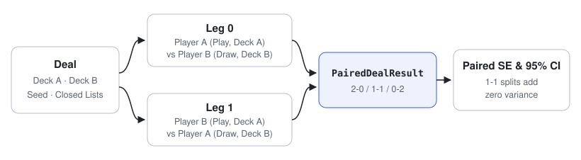
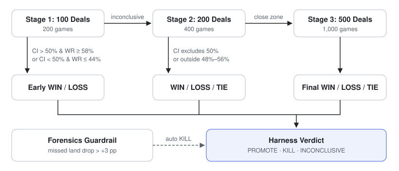

# Evaluation

Magic has high deal variance from draws, mana screw, and play/draw order.
`jace.eval` combines mirrored deals, parallel workers, adaptive stopping,
forensics, and probe diffs to judge win rate and decision quality.

## Mirrored paired deals

<picture>
  <source media="(prefers-color-scheme: dark)" srcset="../assets/mirrored-deals-dark.svg">
  
</picture>

- **Parallel execution (`play_deals_parallel`).** Shards deals round-robin
  across single-threaded CPU workers, caches checkpoints per worker, and
  isolates engine errors per leg.
- **Held-out decks (`jace.collect.decks`, `build_human_deals`).** Uses the
  CRC-32 `split_key` partition from `jace.data.store` so evaluation draws only
  from unseen decks.

## Adaptive sequential judging

`evaluate_adaptive` and `jace.train.harness` step through a deterministic deal
stream (`100 -> 200 -> 500` deals = `200 -> 400 -> 1,000` games) to stop early
on clear outcomes:

<picture>
  <source media="(prefers-color-scheme: dark)" srcset="../assets/adaptive-judging-dark.svg">
  
</picture>

## Behavioral forensics (`jace.eval.forensics`)

`run_forensics` audits mirrored games against `managym.Heuristic` (default 20
deals = 40 games) and optionally records Academy replays (`ScalarCapture`):

| Metric | Catches |
| --- | --- |
| `missed_land_drop_rate` | Passing on an empty stack with a legal land drop |
| `attack_rate` / `attack_declare_spread` | Attack selectivity vs. Heuristic and `declare_attacker` entropy |
| `block_rate` / `block_agreement` | Blocker selectivity and Heuristic agreement on `declare_blocker` |
| `wrong_side_target_rate` | Targeting the wrong side when both sides have legal targets |
| `entropy_by_kind` / `heuristic_agreement_by_kind` | Calibration and drift by decision type |

## Probe-state diffs (`jace.eval.diffs`)

`capture_probes` saves deterministic states `(deal, prefix_actions)` across
priority, attack, block, and targeting; `diff_checkpoints` replays them to
compare two checkpoints on identical observations:

| Metric | Meaning |
| --- | --- |
| `mean_tv` / `mean_kl` | Mean total-variation distance and KL divergence between policies |
| `argmax_flip_rate` | Share of probes where the top action changed |
| `mean_abs_value_delta` | Mean absolute shift in predicted win probability |
| `top_shifts` | Largest policy shifts with readable action labels |
