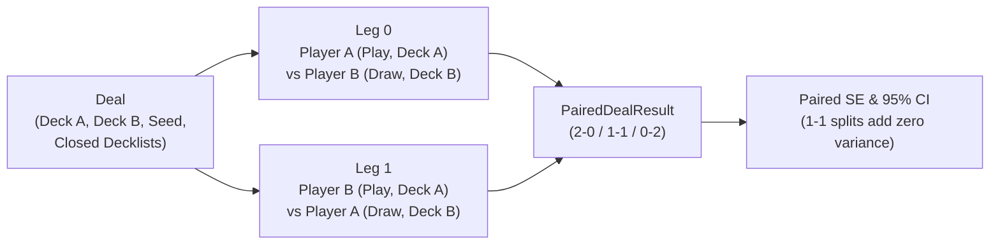
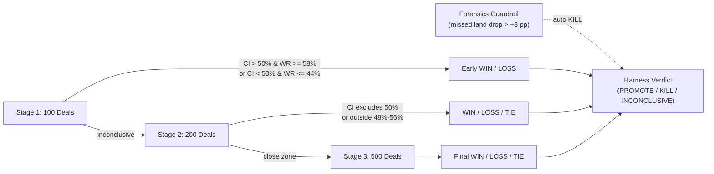

# Evaluation

Magic has high deal variance from draws, mana screw, and play/draw order.
`jace.eval` pairs mirrored deals, parallel CPU execution, sequential adaptive
stopping, behavioral forensics, and probe-state diffs so every checkpoint is
judged on both win rate and decision quality.

## Mirrored paired deals

- **Parallel execution (`play_deals_parallel`).** Shards deals round-robin
  across spawned single-threaded CPU workers, caches each checkpoint once per
  worker, and isolates rare engine errors per leg without aborting the match.
- **Disjoint held-out decks (`jace.collect.decks`,
  `jace.eval.deals.build_human_deals`).** Uses the deterministic CRC-32
  `split_key` partition from `jace.data.store` so evaluation draws strictly from
  unseen held-out decks.

## Adaptive sequential judging

`evaluate_adaptive` and `jace.train.harness` step through a shared deterministic
deal stream (`100 -> 200 -> 500` deals = `200 -> 400 -> 1,000` games) to stop
early on clear wins or losses while saving budget for close matchups:

## Behavioral forensics (`jace.eval.forensics`)

`run_forensics` audits live mirrored games against `managym.Heuristic` (default
20 deals = 40 games) and optionally records `managym` Academy replays
(`ScalarCapture`):

| Metric                                            | What it catches                                                                 |
| ------------------------------------------------- | ------------------------------------------------------------------------------- |
| `missed_land_drop_rate`                           | Passing priority on an empty stack when a legal land drop is available          |
| `attack_rate` / `attack_declare_spread`           | Attack selectivity vs. Heuristic and policy entropy on `declare_attacker`       |
| `block_rate` / `block_agreement`                  | Blocker selectivity and agreement with Heuristic on `declare_blocker`           |
| `wrong_side_target_rate`                          | Targeting the opposite side of the board when both sides have legal targets     |
| `entropy_by_kind` / `heuristic_agreement_by_kind` | Calibration and policy drift broken down by decision type                       |

## Probe-state checkpoint diffs (`jace.eval.diffs`)

`capture_probes` saves deterministic decision states `(deal, prefix_actions)`
covering priority, attack, block, and targeting. `diff_checkpoints` replays
those states once and compares two checkpoints on identical observations:

| Metric                 | Meaning                                                                  |
| ---------------------- | ------------------------------------------------------------------------ |
| `mean_tv` / `mean_kl`  | Mean total-variation distance and KL divergence between action policies  |
| `argmax_flip_rate`     | Fraction of probe states where the highest-probability action changed    |
| `mean_abs_value_delta` | Mean absolute shift in predicted win probability                         |
| `top_shifts`           | Largest individual policy shifts with readable action labels             |
