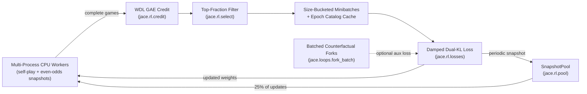
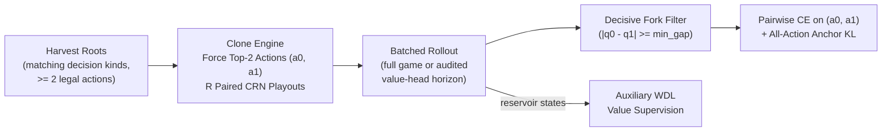

# Gameplay RL

Gameplay training learns a closed-decklist Magic policy and 3-class Win/Draw/Loss critic over `managym` using pure-tensor RL primitives in `jace.rl` and multi-process orchestration in `jace.loops`.

## Self-play update loop



## Policy backbone

| Component           | Configuration                                                                    |
| ------------------- | -------------------------------------------------------------------------------- |
| Observations        | `policy_input_version=11`, closed decklists, 80 cards and 64 permanents per side |
| Card representation | Semantic encoder over `managym` engine program tokens (cached once per epoch)    |
| Trunk               | Transformer width 160 (`train_full_data`) or 64 (`train_ten_decks`), 2 layers, 4 heads |
| Action head         | FiLM-conditioned legal action embeddings (`policy_film=True`)                    |
| Value head          | `categorical_wdl` (3-class Loss / Draw / Win logits) with `masked_mean` pooling  |

## Core RL mechanics

| Stage          | Implementation                                                                                                  |
| -------------- | --------------------------------------------------------------------------------------------------------------- |
| Rollouts       | Complete games (`batch_closure="complete-games"`) under one frozen weight snapshot; isolated per-game error recovery |
| Credit         | `gae_wdl`: undiscounted (`gamma=1.0`), `lam_policy=0.5`, `lam_value=0.8`, wave-vectorized reverse scan (`_reverse_waves`) |
| Row selection  | `top_fraction` keeps top `|advantage|` rows (`>= 0.01`) for policy loss; critic trains on all rows              |
| Advantage scale | Raw win-probability scale (`normalize_advantages=False`) preserves weight on decisive turns                    |
| Minibatching   | `bucketed_minibatch_order` groups similar board sizes to minimize padding; catalog tokens encode once per epoch |
| Diagnostics    | `GradientAgreementTracker` logs consecutive-update gradient cosine similarity                                   |

## Damped policy objective

`damped_policy_loss` in [`jace/rl/losses.py`](../../src/jace/rl/losses.py) implements the Ataraxos damped policy-gradient objective with float64 importance-ratio math:

```text
L = L_clip(ratio, A)
  + collection_kl * KL(pi || pi_behavior)
  + magnet_kl     * KL(pi || pi_reference)
  + value_coef    * CE(v_wdl, target_wdl)
```

| Term            | Default               | Role                                                                            |
| --------------- | --------------------- | ------------------------------------------------------------------------------- |
| `collection_kl` | `0.1`                 | Pulls updated policy toward the frozen rollout behavior distribution            |
| `magnet_kl`     | Scheduled (`tau`)     | Pulls toward `action_type_uniform` reference; decayed via `DecaySchedule` or `DampedSchedule` |
| `value_coef`    | `1.0`                 | Cross-entropy on 3-class WDL lambda-returns                                     |

Plain clipped `ppo_loss` with an entropy bonus is also available for baselines.

## Historical snapshots and nested curricula

- **`SnapshotPool` (`jace.rl.pool`).** Keeps a bounded FIFO ring of detached CPU weights (`max_size=16`, saved every 10 updates). On `snapshot_fraction=0.25` of updates, one seat plays a past checkpoint. `matching="even_odds"` tracks an EMA win rate `p` per snapshot and samples proportionally to `max(0.05, p * (1 - p))`.
- **Sharded deck loading (`jace.loops.collect_pool`).** Workers load `decks.pt` once and rotate `UniformDecks` shards (`shard_size=512`, refreshed every 50 updates) to avoid per-startup validation overhead.
- **Nested color-balanced curricula (`jace.eval.human_decks`).** `nested_card_pools` greedily expands card pools to maximize log-balanced coverage across all 10 two-color pairs, keeping all five colors represented at small pool sizes. `--curriculum-stages` blends transitions smoothly over `--curriculum-blend-updates` updates.

## Batched counterfactual forks

To break collapsed low-entropy habits (such as attacking with every creature every turn), `jace.loops.fork_batch` and `jace.rl.losses.fork_pairwise_loss` intervene directly with exact engine cloning (`env.clone_env()`):



- **Full-strength gradient under collapse.** Restricted to `(a0, a1)`, the pairwise cross-entropy gradient `p - target` stays strong even when a collapsed policy puts `p = 0.999` on the worse move.
- **Horizon auditing.** `audit_horizon_correlation` in [`jace/loops/fork_audit.py`](../../src/jace/loops/fork_audit.py) checks correlation and sign agreement between value-head gaps at candidate horizons and full-game outcomes before enabling truncated rollouts.
