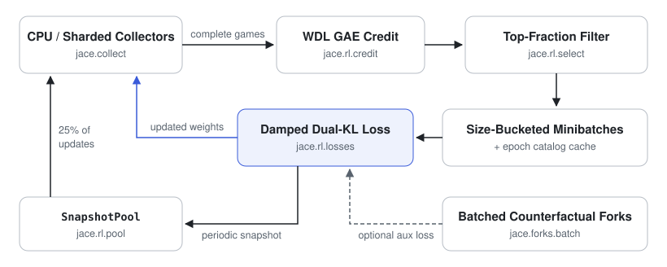
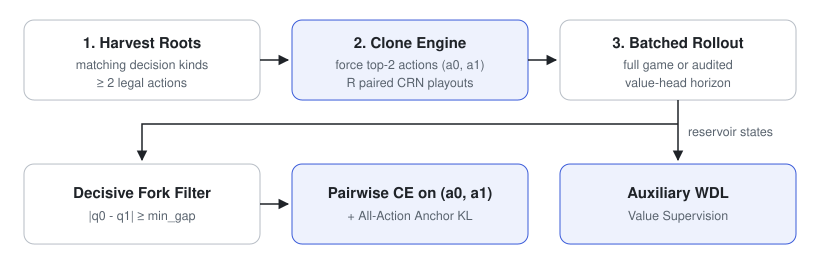

# Gameplay RL

Self-play trains a closed-decklist policy and 3-class Win/Draw/Loss (WDL) critic
over `managym`. Pure-tensor RL math lives in `jace.rl`, collection in
`jace.collect`, counterfactual forks in `jace.forks`, and CLIs in `jace.train`.

## Self-play update loop

<picture>
  <source media="(prefers-color-scheme: dark)" srcset="../assets/self-play-loop-dark.svg">
  
</picture>

## Policy backbone

| Component | Configuration |
| --- | --- |
| Observations | `policy_input_version=11`, closed decklists, 80 cards and 64 permanents per side |
| Card encoder | Semantic encoder over `managym` program tokens (cached once per epoch) |
| Trunk | Transformer width `160` (`full_data`) or `64` (`ten_decks`), `2` layers, `4` heads |
| Action head | FiLM-conditioned legal action embeddings (`policy_film=True`) |
| Value head | `categorical_wdl` (Loss / Draw / Win logits) with `masked_mean` pooling |

## Core RL mechanics

| Stage | Behavior |
| --- | --- |
| Rollouts | Complete games (`batch_closure="complete-games"`) under one snapshot; per-game error isolation |
| Credit | `gae_wdl`: `gamma=1.0`, `lam_policy=0.5`, `lam_value=0.8`, wave-vectorized `_reverse_waves` |
| Row selection | `top_fraction` keeps top `\|advantage\|` rows (`>= 0.01`) for policy; critic uses all rows |
| Advantage scale | Raw win-probability scale (`normalize_advantages=False`) preserves weight on decisive turns |
| Minibatching | `bucketed_minibatch_order` groups similar board sizes to cut padding; catalog encodes once per epoch |
| Diagnostics | `GradientAgreementTracker` logs consecutive-update gradient cosine similarity |

## Damped policy objective

`damped_policy_loss` ([`jace/rl/losses.py`](../../src/jace/rl/losses.py))
implements the Ataraxos damped policy-gradient objective in float64 ratio math:

```text
L = L_clip(ratio, A)
  + collection_kl * KL(pi || pi_behavior)
  + magnet_kl     * KL(pi || pi_reference)
  + value_coef    * CE(v_wdl, target_wdl)
```

| Term | Default | Role |
| --- | --- | --- |
| `collection_kl` | `0.1` | Pulls updated policy toward frozen rollout policy |
| `magnet_kl` | Scheduled (`tau`) | Pulls toward `action_type_uniform` via `DecaySchedule` or `DampedSchedule` |
| `value_coef` | `1.0` | Cross-entropy on 3-class WDL lambda-returns |

Plain clipped `ppo_loss` with an entropy bonus is available for baselines.

## Snapshots and curricula

- **`SnapshotPool` (`jace.rl.pool`).** FIFO ring of CPU weights (`max_size=16`,
  saved every 10 updates). On `snapshot_fraction=0.25` of updates, one seat
  plays a past checkpoint; `matching="even_odds"` samples proportional to
  `max(0.05, p * (1 - p))` using each snapshot's EMA win rate `p`.
- **Sharded deck loading (`jace.collect.{pool,local}`).** Workers load
  `decks.pt` once and rotate `UniformDecks` shards (`shard_size=512`, every 50
  updates).
- **Nested curricula (`jace.collect.decks`).** `nested_card_pools` greedily
  expands pools for log-balanced coverage across all 10 two-color pairs;
  `--curriculum-stages` blends transitions over `--curriculum-blend-updates`.

## Batched counterfactual forks

To break collapsed low-entropy habits (such as alpha-striking every turn),
`jace.forks.batch` and `jace.rl.losses.fork_pairwise_loss` intervene via exact
engine cloning (`env.clone_env()`):

<picture>
  <source media="(prefers-color-scheme: dark)" srcset="../assets/counterfactual-forks-dark.svg">
  
</picture>

- **Strong gradient under collapse.** Restricted to `(a0, a1)`, pairwise
  cross-entropy (`p - target`) stays strong even at `p = 0.999` on the worse
  move.
- **Horizon auditing.** `audit_horizon_correlation`
  ([`jace/forks/audit.py`](../../src/jace/forks/audit.py)) verifies value-head
  correlation and sign agreement against full games before truncating rollouts.
