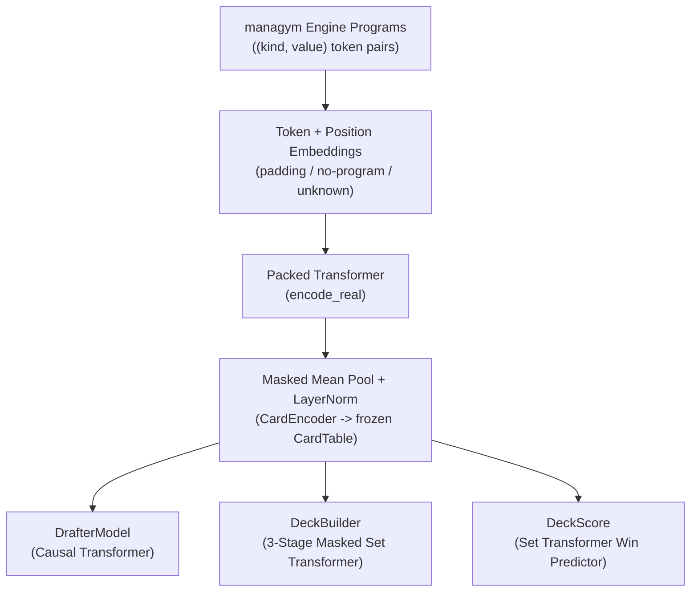
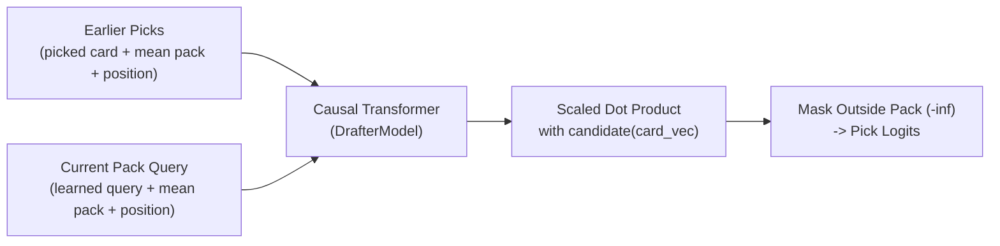

# Limited models

Drafting and deck building share one program-based card representation so every model scores cards from their mechanics alone, with no per-card IDs, no fixed card output heads, and no usage statistics.

## Shared program card encoder

| Symbol / constant   | Role                                                                                   |
| ------------------- | -------------------------------------------------------------------------------------- |
| `CardEncoder`       | Encodes each card's `managym` program tokens into a `width`-dim vector (default `64`)  |
| `CardTable`         | Parameter-free frozen snapshot (`frozen_table(encoder)`) shared by downstream models   |
| `CardVectors`       | Protocol satisfied by both `CardEncoder` and `CardTable`                               |
| Special token IDs   | `0` = `PADDING_TOKEN`, `1` = `NO_PROGRAM_TOKEN`, `2` = `UNKNOWN_TOKEN`, `3+` = catalog pairs (`MAX_PROGRAM_TOKENS = 256`) |
| `own_parameters`    | Excludes shared card-encoder weights from a model's optimizer so embeddings step once  |

## Drafter (`jace.draft`)

`DrafterModel` in [`jace/draft/model.py`](../../src/jace/draft/model.py) is a causal transformer (default width `256`, `6` layers, `8` heads, dropout `0.2`) over a seat's pick sequence:

- **Single-pass training (`whole_draft`).** Interleaves picked tokens and query tokens under one `2t`-length causal mask, producing exact pick-by-pick logits for an entire draft in one forward pass.
- **Parallel pods (`jace.draft.pod`).** `advance` steps batches of 8-seat booster pods from `Picking` to `Complete` in one batched model call per pick.

## Deck builder and deck score (`jace.decks`)

Both models read distinct cards and `log1p`-scaled copy counts through `CardSetEncoder` (permutation-invariant transformer, default width `128`, `3` layers, `4` heads).

| Component       | Details                                                                                         |
| --------------- | ----------------------------------------------------------------------------------------------- |
| `DeckScore`     | Pools encoded deck tokens to a single win-probability logit; trained with binomial `score_loss` |
| `DeckBuilder`   | Enforces `BuildRules` via hard masks at every stage so every sampled deck is legal              |
| `sample_builds` | Samples batches of legal decks with exact log-probabilities                                     |
| `build_log_probs` | Recomputes differentiable log-probabilities in one pass for teacher forcing or policy gradient |
| `build_decks`   | Samples candidates, deduplicates, scores each unique deck once with `DeckScore`, keeps top `k`  |

## Limited formats (`jace.loops.formats`)

`LimitedFormat` centralizes format geometry so no model hardcodes set sizes:

| Format        | Seats | Boosters          | Deck size | Land range |
| ------------- | ----- | ----------------- | --------- | ---------- |
| `TLA_LIMITED` | 8     | 3 × 14-card packs | 40        | 15 to 18   |
