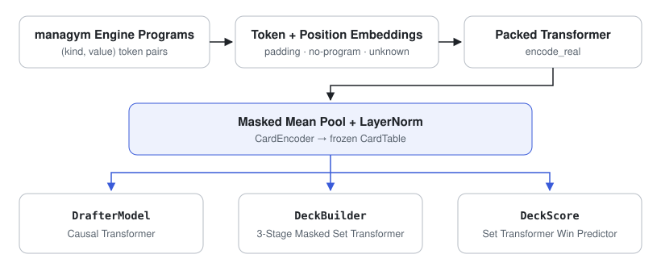
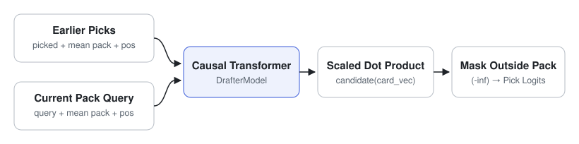
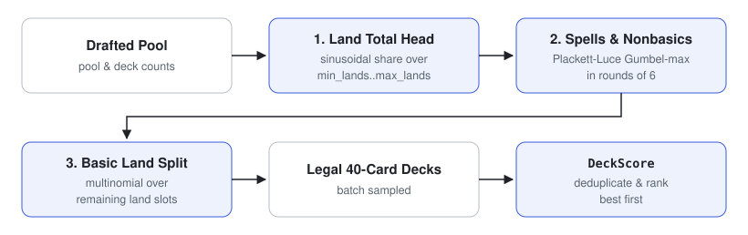

# Limited models

Drafting and deck building share one program-based card encoder so models score
cards from mechanics alone, with no per-card IDs, fixed card heads, or usage
statistics.

## Shared program card encoder

<picture>
  <source media="(prefers-color-scheme: dark)" srcset="../assets/card-encoder-dark.svg">
  
</picture>

| Symbol | Role |
| --- | --- |
| `CardEncoder` | Encodes `managym` program tokens to `width`-dim vectors (default `64`) |
| `CardTable` | Parameter-free frozen snapshot (`frozen_table(encoder)`) shared downstream |
| `CardVectors` | Protocol satisfied by `CardEncoder` and `CardTable` |
| Special tokens | `0` `PADDING_TOKEN`, `1` `NO_PROGRAM_TOKEN`, `2` `UNKNOWN_TOKEN`, `3+` catalog (`MAX_PROGRAM_TOKENS = 256`) |
| `own_parameters` | Excludes shared encoder weights from downstream optimizers |

## Drafter (`jace.draft`)

`DrafterModel` ([`jace/draft/model.py`](../../src/jace/draft/model.py)) is a
causal transformer (width `256`, `6` layers, `8` heads, dropout `0.2`) over a
seat's pick sequence:

<picture>
  <source media="(prefers-color-scheme: dark)" srcset="../assets/drafter-flow-dark.svg">
  
</picture>

- **Single-pass training (`whole_draft`).** Interleaves pick and query tokens
  under one `2t` causal mask for exact pick-by-pick logits in one pass.
- **Parallel pods (`jace.draft.pod`).** `advance` steps batched 8-seat pods from
  `Picking` to `Complete` in one model call per pick.

## Deck builder and deck score (`jace.decks`)

Both models read distinct cards and `log1p`-scaled copy counts through
`CardSetEncoder` (permutation-invariant transformer: width `128`, `3` layers,
`4` heads).

<picture>
  <source media="(prefers-color-scheme: dark)" srcset="../assets/deck-builder-dark.svg">
  
</picture>

| Component | Role |
| --- | --- |
| `DeckScore` | Pools deck tokens to a win-probability logit; binomial `score_loss` |
| `DeckBuilder` | Hard-masks `BuildRules` at each stage so every sample is legal |
| `sample_builds` | Batch-samples legal decks with exact log-probabilities |
| `build_log_probs` | One-pass differentiable log-probabilities for teacher forcing or RL |
| `build_decks` | Samples candidates, deduplicates, scores each once, keeps top `k` |

## Limited formats (`jace.pretrain.formats`)

`LimitedFormat` centralizes format geometry:

| Format | Seats | Boosters | Deck size | Land range |
| --- | --- | --- | --- | --- |
| `TLA_LIMITED` | 8 | 3 × 14-card packs | 40 | 15 to 18 |
