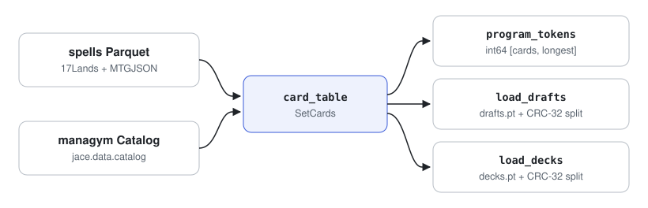

# Data

jace reads [17Lands](https://www.17lands.com/public_datasets) Premier Draft
exports (CC BY 4.0) and [MTGJSON](https://mtgjson.com/) card metadata via
[spells](https://github.com/oelarnes/spells).

## Downloading a set

```sh
uv run spells add TLA
```

Files live in `~/.local/share/spells` (or `$SPELLS_DATA_HOME`). jace never
downloads automatically; missing sets raise `SetNotDownloadedError` naming
`uv run spells add <set>`.

| Table | Row grain | Columns read |
| --- | --- | --- |
| Draft data | Pick | Pack contents, pick, player skill, event result |
| Game data | Game | Main deck, sideboard, build index, outcome |
| Card attributes | Card | Name, set, rarity, type, mana value, oracle text |

## Cached tensor pipeline

<picture>
  <source media="(prefers-color-scheme: dark)" srcset="../assets/data-pipeline-dark.svg">
  
</picture>

```python
from jace.data import card_table, load_decks, load_drafts, program_tokens, read_set
from jace.data.catalog import engine_cards, program_vocabulary

data = read_set("TLA")
programs = {card.name: card.program for card in engine_cards()}
cards = card_table(data.attributes, data.statistics, programs=programs)
tokens = program_tokens(cards.pool, vocabulary=program_vocabulary())
drafts = load_drafts(data.picks, pool=cards.pool, cache_dir=cache_dir, held_out_share=0.1)
decks = load_decks(data.games, pool=cards.pool, cache_dir=cache_dir, held_out_share=0.1)
```

### Key behaviors

- **Engine catalog (`jace.data.catalog`).** `engine_cards` returns deck-eligible
  programs; `program_vocabulary` numbers every `(kind, value)` pair.
- **Program tokens (`program_tokens`).** IDs start at `FIRST_PROGRAM_TOKEN`
  (`3`), reserving `0` (`PADDING_TOKEN`), `1` (`NO_PROGRAM_TOKEN`), and `2`
  (`UNKNOWN_TOKEN`).
- **Deterministic split.** Each draft gets a CRC-32 `split_key`
  (`jace.data.store.SPLIT_KEYS`). Drafts with
  `split_key < round(held_out_share * SPLIT_KEYS)` (`0.1` default) stay held out
  across `load_drafts`, `load_decks`, and `load_human_deck_catalog`.
- **No usage stats in card vectors.** `cards.ata` is used only by the untrained
  earliest-pick baseline in `jace.pretrain.draft`.
- **Deck extraction (`load_decks`).** Keeps one deck per draft (most-played
  `build_index`, lowest index on ties) with `pools = decks + sideboards` and
  event `wins`/`losses`.
- **Missing P1P1 recovery (`load_drafts`).** For sets omitting P1P1 (such as
  `TLA`), pick 1 is reconstructed from the pick-2 pool with weight `0` (history
  only, never trained or scored).
