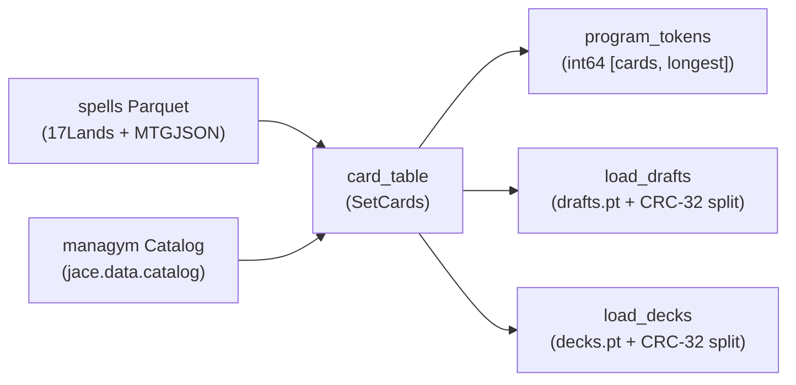

# Data

jace reads public Premier Draft exports from
[17Lands](https://www.17lands.com/public_datasets) (Creative Commons Attribution
4.0) and card metadata from [MTGJSON](https://mtgjson.com/).

## Downloading a set

The [spells](https://github.com/oelarnes/spells) package downloads 17Lands
exports and MTGJSON attributes as Parquet:

```sh
uv run spells add TLA
```

Files live in `~/.local/share/spells` (or `$SPELLS_DATA_HOME`). jace never
downloads datasets automatically. If a set is missing, `jace.data.read_set`
raises `SetNotDownloadedError` naming `uv run spells add <set>`.

| Table           | One row per | Columns read                                          |
| --------------- | ----------- | ----------------------------------------------------- |
| Draft data      | Pick        | Pack contents, card taken, player skill, event result |
| Game data       | Game        | Main deck, sideboard, build index, game outcome       |
| Card attributes | Card        | Name, set code, rarity, card type, mana value, oracle text |

## Cached tensor pipeline



```python
from jace.data import card_table, load_decks, load_drafts, program_tokens, read_set
from jace.data.catalog import engine_cards, program_vocabulary

data = read_set("TLA")
programs = {card.name: card.program for card in engine_cards()}
cards = card_table(data.attributes, data.statistics, programs=programs)
tokens = program_tokens(cards.pool, vocabulary=program_vocabulary())
drafts = load_drafts(data.picks, pool=cards.pool, cache_dir=cache_dir, held_out_share=0.1)
decks = load_decks(data.games, pool=cards.pool, cache_dir=cache_dir, held_out_share=0.1)
```

### Key behaviors

- **Engine catalog seam (`jace.data.catalog`).** Exposes every deck-eligible
  card's engine program (`engine_cards`) and numbers every `(kind, value)` pair
  in `managym`'s token catalog (`program_vocabulary`).
- **Program tokenization (`program_tokens`).** Maps each card's `(kind, value)`
  pairs to token IDs starting at `FIRST_PROGRAM_TOKEN` (`3`), reserving `0`
  (`PADDING_TOKEN`), `1` (`NO_PROGRAM_TOKEN`), and `2` (`UNKNOWN_TOKEN`).
- **Deterministic train / held-out split.** Every draft gets a CRC-32
  `split_key` (`jace.data.store.SPLIT_KEYS`). Drafts with
  `split_key < round(held_out_share * SPLIT_KEYS)` (`0.1` default) are held out
  consistently across `load_drafts`, `load_decks`, and
  `jace.collect.decks.load_human_deck_catalog`.
- **No usage statistics in card vectors.** `cards.ata` stores 17Lands average
  pick position strictly for the untrained earliest-pick baseline in
  `jace.pretrain.draft`.
- **Deck extraction (`load_decks`).** Keeps one representative deck per draft
  (the `build_index` played in the most games, tie-breaking by lowest
  `build_index`), with `pools = decks + sideboards` and event totals for `wins`
  and `losses`.
- **Missing first-pick recovery (`load_drafts`).** For sets where Arena's log
  omits pack-1 pick-1 rows (such as `TLA`), `load_drafts` reconstructs pick 1
  from the pick-2 pool with training weight `0` so the drafter sees it in
  history without training or scoring on it.
