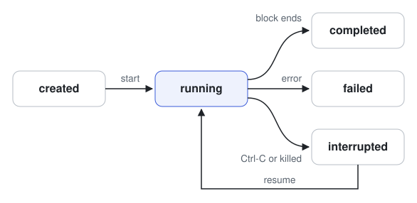

# Run records

A training run is recorded as plain files in one folder. `jace.tracking` is
the only code that writes them, and any program can read them. The layout
is a contract: a frontend can rely on it.

```text
<root>/<run id>/
  identity.json        what the run is, written once
  state.jsonl          one line per state change
  metrics.jsonl        one line per update per model
  evaluations.jsonl    one line per evaluation
  checkpoints/
    <model>-<update>.pt  the model's weights
    index.jsonl          one line per checkpoint
  lock                 held by the process that is writing
```

A run id is the creation time and eight characters of a hash, such as
`20261111T153045Z-1a2b3c4d`, so ids sort by time.

## Fields

Every `.jsonl` file holds one JSON object per line.

| File                | Fields                                                              |
| ------------------- | ------------------------------------------------------------------- |
| `identity.json`     | `format`, `run_id`, `created`, `config`, `seed`, `jace_commit`, `manabot_commit`, `inputs` |
| `state.jsonl`       | `state`, `time`, and `error` when the state is `failed`             |
| `metrics.jsonl`     | `model`, `update`, `metrics`                                        |
| `evaluations.jsonl` | `checkpoint`, `opponent`, `deals`, `rate`, `low`, `high`            |
| `index.jsonl`       | `model`, `update`, `sha256`                                         |

`inputs` lists the checkpoints from other runs that this run started from.
Each is an object with `run_id`, `model`, `update` and `sha256`. That list
is how one run's lineage is traced to another.

Times are ISO 8601 in UTC. No number is ever NaN or infinite: logging one
raises an error.

## States

<picture>
  <source media="(prefers-color-scheme: dark)" srcset="../assets/run-states-dark.svg">
  
</picture>

The last line of `state.jsonl` is the run's state, with one exception. A
killed process cannot record its own end. So a run whose last state is
`running`, with no process holding the lock, is interrupted. `read_state`
records that line when it finds it.

## Writing a run

```python
folder = create_run(root, identity, clock=clock)
with writing(folder, clock=clock) as run:
    log_update(run, model="player", update=1, metrics={"loss": 0.42})
    reference = save_checkpoint(run, model="player", update=1, module=player)
```

Everything is written inside the `with` block. Leaving it records how the
run ended: completed, failed with the error, or interrupted on Ctrl-C. A
second process that tries to write the same run is refused.

`load_checkpoint` checks a file's hash against its reference before loading
it, and refuses a file that does not match.
