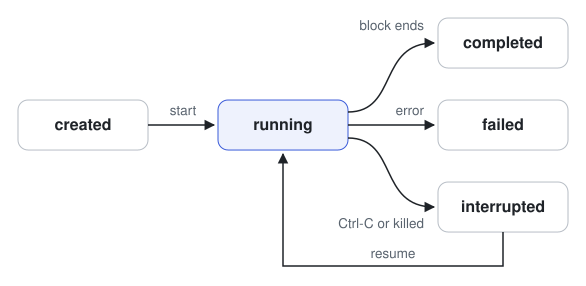

# Run records

A training run is recorded as plain files in one folder. `jace.tracking` is
the only code that writes them, and any program can read them. The layout
is a contract: a frontend can rely on it.

```text
<root>/<run id>/
  identity.json        what the run is, written once
  state.jsonl          one line per state change
  metrics.jsonl        one line per update per model
  evaluations.jsonl    one line per evaluation
  checkpoints/
    <model>-<update>.pt  the model's weights
    index.jsonl          one line per checkpoint
  lock                 held by the process that is writing
```

A run id is the creation time and eight characters of a hash, such as
`20261111T153045Z-1a2b3c4d`, so ids sort by time.

## Fields

Every `.jsonl` file holds one JSON object per line.

| File                | Fields                                                              |
| ------------------- | ------------------------------------------------------------------- |
| `identity.json`     | `format`, `run_id`, `created`, `config`, `seed`, `jace_commit`, `manabot_commit`, `inputs` |
| `state.jsonl`       | `state`, `time`, and `error` when the state is `failed`             |
| `metrics.jsonl`     | `model`, `update`, `metrics`                                        |
| `evaluations.jsonl` | `checkpoint`, `opponent`, `deals`, `rate`, `low`, `high`, and `details` when the evaluation recorded more |
| `index.jsonl`       | `model`, `update`, `sha256`                                         |

`inputs` lists the checkpoints from other runs that this run started from.
Each is an object with `run_id`, `model`, `update` and `sha256`. That list
is how one run's lineage is traced to another.

Times are ISO 8601 in UTC. No number is ever NaN or infinite: logging one
raises an error.

## States

<picture>
  <source media="(prefers-color-scheme: dark)" srcset="../assets/run-states-dark.svg">
  
</picture>

The last line of `state.jsonl` is the run's state, with one exception. A
killed process cannot record its own end. So a run whose last state is
`running`, with no process holding the lock, is interrupted. `read_state`
records that line when it finds it.

## Writing a run

```python
folder = create_run(root, identity, clock=clock)
with writing(folder, clock=clock) as run:
    log_update(run, model="player", update=1, metrics={"loss": 0.42})
    reference = save_checkpoint(run, model="player", update=1, module=player)
```

Everything is written inside the `with` block. Leaving it records how the
run ended: completed, failed with the error, or interrupted on Ctrl-C. A
second process that tries to write the same run is refused.

## Scoring a run that has ended

```python
with evaluating(run_folder) as run:
    record_evaluation(run, checkpoint=reference, opponent="heuristic", deals=50, rate=0.31, low=0.26, high=0.36)
```

A checkpoint is scored after its run has ended, and `writing` refuses a
completed or failed run. `evaluating` takes the same lock and leaves the
run's state alone, so evaluations can be added to a run in any state that
no process is writing.

`jace.loops.score` writes one line for each checkpoint in each pair it
plays. `rate` is the checkpoint's win rate over `deals` paired deals. Its
`details` hold `games`, `abandoned` and `hung`, the `seed` and
`game_seconds` of the scoring, `games_per_second`, and `guess`: the guess
model's `loss` and `base_rate_loss` on those games with its `stated` and
`observed` chances, where a range with no guess is null. A line whose
`opponent` is `population` holds the checkpoint's win rate over all the
other players it met, and in `details` its `rating` with `rating_low` and
`rating_high`, the `anchor` player rated 1000 and the `opponents`.

## Reading a checkpoint

```python
reference = latest_checkpoint(run_folder, "drafter")
load_checkpoint(run_folder.parent, reference, into=drafter, keeping=embedding)
```

`latest_checkpoint` returns the reference of a model's newest checkpoint in
a run. `load_checkpoint` checks the file's hash against the reference
before loading it, and refuses a file that does not match.

A model's checkpoint also holds the card embedding the model was saved
with. `keeping` names a module the load must leave as it was, so loading a
model never replaces the shared embedding. Load the embedding from its own
checkpoint, with `keeping=None`.
