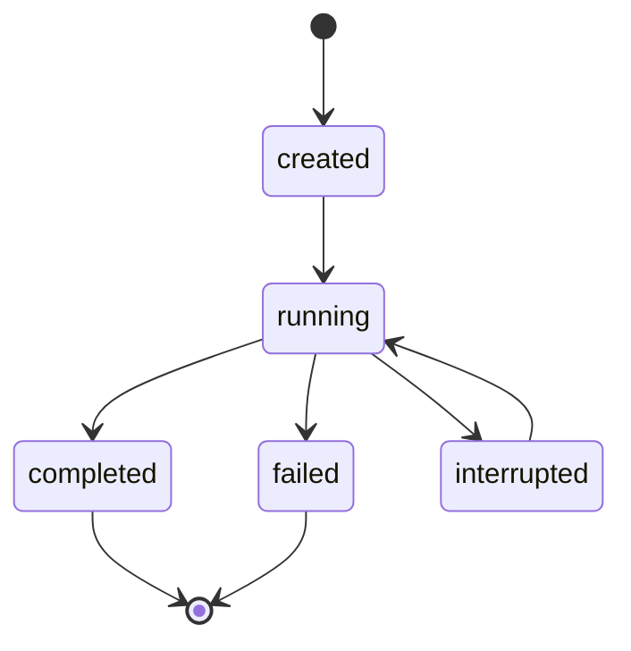

# Run records

This page describes the files a training run writes to disk, field by field,
and the states a run moves through. `jace.tracking` is the only code that
writes them.

There is no tracking service. A run is a folder that any program can read.
The layout is a public contract for a frontend that reads these files
directly, so a change to a file name or a field is a breaking change. No
frontend is built yet, and no training run has written a record yet. The
examples on this page come from calling `jace.tracking` by hand.

## The folder

```text
<root>/<run id>/
  identity.json          what the run is, written once
  state.jsonl            one line per state change
  metrics.jsonl          one line per update per model
  evaluations.jsonl      one line per evaluation
  checkpoints/
    <model>-<update>.pt  a state dict, with the update zero padded to 8 digits
    index.jsonl          one line per checkpoint
  lock                   held with flock by the process that is writing
```

`create_run` makes the folder and every file in it except the checkpoints,
so each file exists from creation.

The run id is the creation time in UTC to the second, a dash, and the first
8 hex digits of the SHA-256 of the identity, for example
`20261111T220835Z-08174799`. Ids therefore sort by creation time as text.
Creating two runs with the same identity in the same second raises
`RunExistsError`.

## Rules for every file

- Every `.jsonl` file holds one JSON object per line. Each line is written
  whole with a single append, so a killed process leaves no half line.
- No value is NaN or infinite. Logging one raises `ValueError`.
- Times are ISO 8601 in UTC.
- A model is named `embedding`, `drafter`, `deck_builder`, `deck_score`,
  `guess` or `player`.
- Nothing is fsynced. The record survives a killed process, and may not
  survive a power loss.

## identity.json

One JSON object, written once by `create_run`.

| Field            | Value                                                                    |
| ---------------- | ------------------------------------------------------------------------ |
| `format`         | The version of this layout. It is `1`.                                   |
| `run_id`         | The run id, which is also the folder's name.                             |
| `created`        | The creation time.                                                       |
| `config`         | The run's configuration, an object the caller chooses.                   |
| `seed`           | The run's seed, an integer.                                              |
| `jace_commit`    | The jace commit the run uses, supplied by the caller.                    |
| `manabot_commit` | The manabot commit the run uses, supplied by the caller.                 |
| `inputs`         | A list of [checkpoint objects](#checkpoint-objects) from other runs that this run starts from. |

```json
{
  "format": 1,
  "run_id": "20261111T220835Z-08174799",
  "created": "2026-11-11T22:08:35.757329+00:00",
  "config": {
    "pods": 4
  },
  "seed": 7,
  "jace_commit": "abc123",
  "manabot_commit": "b5e8f40",
  "inputs": []
}
```

`jace.tracking` never runs git and never reads the system clock. The caller
supplies both commits, and a `clock` function that returns the current time.

## state.jsonl

One line per state change.

| Field   | Value                                                                  |
| ------- | ---------------------------------------------------------------------- |
| `state` | `created`, `running`, `completed`, `failed` or `interrupted`.          |
| `time`  | When the run entered the state.                                        |
| `error` | The error's type and message. Present only when the state is `failed`. |

```json
{"state": "created", "time": "2026-11-11T22:08:35.758184+00:00"}
{"state": "running", "time": "2026-11-11T22:08:35.758590+00:00"}
{"state": "completed", "time": "2026-11-11T22:08:35.759819+00:00"}
```

The last line is the run's state, with one exception that
[States](#states) explains.

## metrics.jsonl

One line per update per model, written by `log_update`.

| Field     | Value                                    |
| --------- | ---------------------------------------- |
| `model`   | The model that was updated.              |
| `update`  | The update's number, an integer.         |
| `metrics` | An object from a metric's name to a number. |

```json
{"model": "player", "update": 1, "metrics": {"loss": 0.69}}
```

## evaluations.jsonl

One line per evaluation, written by `record_evaluation`.

| Field           | Value                                                                  |
| --------------- | ---------------------------------------------------------------------- |
| `checkpoint`    | The [checkpoint object](#checkpoint-objects) that was evaluated.       |
| `opponent`      | A name for the opponent, chosen by the caller.                         |
| `deals`         | The number of deals played, an integer.                                |
| `rate`          | The win rate.                                                          |
| `low`, `high`   | The ends of the range around the win rate.                             |

```json
{"checkpoint": {"run_id": "20261111T220835Z-08174799", "model": "player", "update": 1, "sha256": "7648103ab9e48ece2a5fe8fcdfbc252e24a2b0d8788f34799a4e973e9e880f15"}, "opponent": "random", "deals": 200, "rate": 0.55, "low": 0.48, "high": 0.62}
```

## checkpoints/

`save_checkpoint` saves a module's state dict as
`checkpoints/<model>-<update>.pt`, for example `player-00000001.pt`. The
zero padding makes file names sort by update as text.

The file is written under a temporary name ending in `.partial` and renamed
once complete, so a file with the final name is never half written. A line
is then added to `checkpoints/index.jsonl`:

| Field    | Value                                  |
| -------- | -------------------------------------- |
| `model`  | The model the checkpoint holds.        |
| `update` | The update it was saved at.            |
| `sha256` | The hex SHA-256 digest of the `.pt` file. |

```json
{"model": "player", "update": 1, "sha256": "7648103ab9e48ece2a5fe8fcdfbc252e24a2b0d8788f34799a4e973e9e880f15"}
```

A `.pt` file with no line in `index.jsonl` was cut off while being saved. A
checkpoint is never overwritten: saving a second one for the same model and
update raises `CheckpointExistsError`.

### Checkpoint objects

A checkpoint object names one checkpoint of any run. It appears in
`identity.json` under `inputs` and in `evaluations.jsonl` under
`checkpoint`.

| Field    | Value                                  |
| -------- | -------------------------------------- |
| `run_id` | The run that saved the checkpoint.     |
| `model`  | The model it holds.                    |
| `update` | The update it was saved at.            |
| `sha256` | The hex SHA-256 digest of the `.pt` file. |

`load_checkpoint` hashes the file first. When the digest differs from the
object's `sha256`, it raises `CheckpointMismatchError` before it loads
anything.

## lock

`lock` is an empty file. The process that is writing the run holds an
exclusive `flock` on it. The lock is an OS lock that ends with its process,
so there is never a stale lock to clean up.

A child process forked inside a `writing` block inherits the lock, and the
run reads as running until that child exits too.

## States



`create_run` makes a run in the state created. The `writing` context manager
makes every later transition: it takes the lock, records running, and
records how its block ended.

| From                     | To            | When                                                                   |
| ------------------------ | ------------- | ---------------------------------------------------------------------- |
| created, interrupted     | `running`     | A `writing` block starts.                                              |
| running                  | `completed`   | The block exits normally.                                              |
| running                  | `failed`      | The block raises any error but `KeyboardInterrupt`. The line records the error. |
| running                  | `interrupted` | The block raises `KeyboardInterrupt`, or the writing process dies.     |

Completed and failed are final. `writing` raises `RunNotResumableError` for
a run in either state. It raises `RunLockedError` when another live process,
or another `writing` block in the same process, holds the run.

### A writer that died

A killed process cannot record its own end, so the last line of
`state.jsonl` stays `running`. A last line of `running` with nobody holding
the lock therefore means interrupted.

`read_state` and `writing` resolve this. Each one tries the lock, and when
it gets the lock on a run whose last line is `running`, it appends an
`interrupted` line. A run left running by a dead writer can therefore be
resumed with `writing` directly.

A reader that does not call `read_state` can test the lock itself: when a
non-blocking exclusive `flock` on `lock` succeeds, no process is writing the
run.
